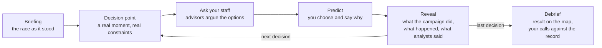

# Ballot to Bill

> Working title. "Capitol Classroom" is the other candidate name.

A case-study tool that teaches students how campaigns are actually run. You are walked through a real New York City race, stop at the moments where the real campaign had to decide something, make the call yourself, and then see what they did, what happened and what people who studied it concluded.

This document is the idea hub. It holds the idea and nothing else: no research, no tech stack, no task plan. Those live in their own docs.

---

## 1. The idea in one page

| | |
|---|---|
| **Student** | Someone who has never worked on a campaign |
| **Role** | Sitting in the chair of a real campaign's decision-maker |
| **Material** | Real races, real candidates, real data from the period |
| **Setting** | New York City, on an accurate map built from the city's own open data |
| **Format** | Predict, then reveal, at four to six real decision points per case |
| **Length** | One case is one sitting. One deep case first, then four more in the same format |
| **What you learn** | How to delegate, budget, read what different groups of voters want and weigh policy trade-offs |

**What changed.** The first version was a simulation: a fictional candidate, invented polls and staff agents acting on an invented world. It taught from imagination. This version teaches from the record.

---

## 2. The loop: predict, then reveal

1. **Briefing.** The race as it stood on a real date: who is running, the money each side has, where each candidate is strong on the map, which voter groups matter.
2. **Decision point.** A real moment the campaign faced, with the constraints they had: money on hand, days left, staff available.
3. **Ask your staff.** Advisors each argue for one option, using only what was known at that date.
4. **Predict.** You choose an option and write one line on why.
5. **Reveal.** What the campaign actually did, what happened next, and what later reporting or research said about it. Every statement carries its source.
6. **Debrief.** After the last decision, the real result on the map, and your calls set against the record across the four skills.

---

## 3. Rules that keep it honest

- **The record, not a counterfactual.** When you choose differently from the real campaign, the tool does not invent what would have happened. It shows what did happen and what evidence exists about the alternative.
- **Every claim has a source.** Results, spending, quotes and conclusions link to where they came from. Anything estimated is labelled as an estimate.
- **Judgment is attributed.** "This would have worked better" is never the tool's own verdict. It is what a named analyst, a staff member looking back, or published research on that tactic said.
- **The real choice is not always the right one.** Some cases follow a campaign that lost. The reveal says what they did, not that it was correct.
- **No hindsight at the table.** Advisors argue from what was known on that date. The outcome is not used until the reveal.
- **Cases are chosen for the lesson.** Not for who won or what they believed. The set of five is balanced, and party primaries are preferred because the contest is inside one party.
- **You are graded on reasoning.** The outcome is public and one search away, so guessing it earns nothing. What counts is whether your choice fits the constraints you were shown.

---

## 4. What a case holds

| Part | Contents |
|---|---|
| **The race** | Office, date, candidates, the final result |
| **The campaign you follow** | The candidate, their record and platform at the time, their team |
| **The city then** | Results by district, turnout, demographics of the period, the issues people were raising |
| **The money** | Dated fundraising and spending from public filings |
| **Decision points** | For each: the date, the situation, the options, what was done, what followed, what was said about it afterwards |
| **Sources** | Every document, dataset and article the case rests on |

A case is a data file. Adding a case means researching and writing one more file, not building more product.

---

## 5. The screens

The four views and the shell stay. Each one now shows the case instead of an invented world.

| Screen | Before | Now |
|---|---|---|
| **Profile** | A fictional candidate's portfolio | The real candidate and race at the briefing date: record, platform, opponents |
| **Map** | Simulated support by district | Real results, turnout and demographics by community district, as they were |
| **Voter groups** | A feelings meter per faction | Who lived where and how those areas voted |
| **War room** | Staff agents who act on the world | Advisors who argue the options at each decision point from the case file |
| **Money** | Invented budget lines | The campaign's real fundraising and spending over time |
| **Newspaper** | Generated morning paper | What the press was reporting at that point, paraphrased and cited |
| **Manifesto** | Planks you write | The platform the candidate actually ran on, and the trade-offs it carried |

---

## 6. The staff, as advisors

The war room keeps its hierarchy and its agents. Their job changes.

- At a decision point, each director argues for one option in their own voice: field, finance, communications.
- They cite the case file: the map, the money, the calendar. They do not know how the race ends.
- You can question them before you choose.
- After the reveal, the same advisors say what they got right and wrong.

Delegation is still taught here: which advisor you ask, how clearly you ask, and whether you can tell a strong argument from a confident one.

---

## 7. What is real and what is not

| Real | Not available, so never claimed |
|---|---|
| Results by election district | What the campaign did hour by hour |
| Census demographics of the period | Why each decision was made, unless someone said so on the record |
| Dated campaign finance filings | How voter groups felt week by week |
| Reporting and post-election analysis | What would have happened on a different path |

Where the record is thin, the case says so.

---

## 8. The cases

One deep case first, then four that each add a different lesson. The shortlist and the reasons for each choice are in the research doc, not here.

---

## 9. Open questions

- Which race is the first deep case.
- Whether the student follows one campaign per case, or can replay the same race from the other side.
- How the debrief scores reasoning without pretending to know the right answer.
- The named user: high school or college, in class or solo.
- The final name.
