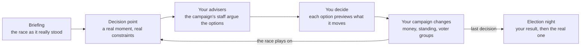

# Campaign Academy

A campaign simulation for students, built on real races. You take over a real New York City campaign at a real moment, with the real candidates, money, polls and voters of that year. At the points where that campaign had to decide something, you decide instead. Your choices change your campaign, the race plays on from there, and at the end you see how your version finished and what really happened.

This document is the idea hub. It holds the idea and nothing else: no research, no tech stack, no task plan. Those live in their own docs.

---

## 1. The idea in one page

| | |
|---|---|
| **Student** | Someone who has never worked on a campaign |
| **Role** | Running a real campaign from the inside |
| **Material** | Real races, real candidates, real data from the period |
| **Setting** | New York City, on an accurate map built from the city's own open data |
| **Format** | A case: four to six real decision points, each of which changes your campaign |
| **How it ends** | Your simulated election night, then the real one beside it |
| **What you learn** | How to delegate, budget, read what different groups of voters want and weigh policy trade-offs |

**What changed.** The first version was a simulation of a fictional candidate in an invented race. This version keeps the simulation and replaces everything it stands on: the people, the situation at each decision, the money and the electorate are taken from the record.

---

## 2. The loop

1. **Briefing.** The race on a real date: who is running, the rules, the money, the polls.
2. **Decision point.** A real moment the campaign faced. What the world did since your last decision is real: rivals enter, scandals break, courts rule.
3. **Your advisers.** The campaign's staff argue for different options.
4. **You decide.** Each option shows a small preview of what it will move, up or down, and nothing more.
5. **Your campaign changes.** Money, poll standing and support among voter groups move, and you see what the real campaign did at that point. The next decision starts from where you left things.
6. **Election night.** Your simulated result against the threshold you needed, then the certified real result and, decision by decision, how the real campaign's choices turned out.

---

## 3. Two layers, kept apart

| | The record | The simulation |
|---|---|---|
| **What it is** | What was true and what happened | What your choices do to your campaign |
| **Examples** | Polls, filings, results, what staff said afterwards | Poll points gained, money spent, support in a voter group |
| **Where it comes from** | Sources, linked on every statement | Invented sizes, fitted to the record |
| **How it is shown** | Marked as real data | Marked as simulated |

The simulation is fitted so that making the real campaign's own choices finishes close to the real result. That is its only anchor. It cannot prove what a different choice would have produced, and it says so.

---

## 4. Rules that keep it honest

- **Every statement of fact has a source.** Anything estimated is labelled as an estimate.
- **The tool never recommends.** Advice comes from the advisers, in their own voices. The tool does not say which option was best, before or after.
- **Previews show direction, not size.** You choose on judgment, then see what moved.
- **The real campaign's choice is shown only after you decide.** Once you have chosen, you see what they did at that point. How it turned out for them is held to the end, so later events are not spoiled.
- **The real choice is not always the right one.** Luck and rivals' mistakes are part of the record and are shown as such.
- **Cases are chosen for the lesson.** Not for who won or what they believed. Party primaries are preferred because the contest is inside one party.

---

## 5. The advisers

The advisers are the campaign's actual staff where the record names them: the campaign manager, the media consultant, the pollster.

- **On the record.** Where a staff member is documented as arguing for something, the adviser says that, with the source.
- **Predicted.** Where the record is silent, the adviser's argument is written from that person's role and documented background, and is labelled as predicted and not a quotation.
- **Roles without a name.** Where nobody is documented in a post, the adviser is the post, not an invented person.

Several advisers argue for different options. Delegation is taught here: whose judgment you weigh for which kind of decision, and whether you can tell a strong argument from a confident one.

---

## 6. What a case holds

| Part | Contents |
|---|---|
| **The race** | Office, date, candidates, rules, the certified result |
| **The campaign you run** | The candidate, their platform at the time, their staff |
| **The starting state** | Money, poll standing and voter-group support at the briefing date, with what each number rests on |
| **Decision points** | For each: what the world did since the last one, the situation, the options with their previews and effects, the advisers, and the record of what the real campaign did, what followed and what was said afterwards |
| **The city then** | Results by district, turnout and demographics of the period |
| **Sources** | Every document, dataset and article the case rests on |

A case is a data file. Adding a case means researching and writing one more file, not building more product.

---

## 7. The screens

| Screen | Shows |
|---|---|
| **Case** | The briefing, each decision, your campaign's current state, election night and the debrief |
| **Profile** | The real candidate and race as of the student's date: record, platform (each plank dated and cited; one that answered a decision appears only after the student makes it), the rivals' platforms, opponents |
| **Map** | The city of that year: demographics and past results by district, and how your standing moves across it |
| **Voter groups** | Who lived where, and your support in each group as your decisions move it |
| **War room** | The campaign's staff as advisers you can question |
| **Money** | What you have left to spend under the cap, against what the real campaign spent and when |
| **Newspaper** | What the press was reporting at that point, paraphrased and cited |

---

## 8. The cases

One deep case first, then four that each add a different lesson. The shortlist and the reasons for each choice are in `docs/research/`.

**First case:** the 2013 Democratic primary for Mayor of New York, run from inside the campaign that started in fourth place.

---

## 9. Open questions

- How the simulated state reaches the map and voter-group screens.
- Whether live agents play the advisers, or the written arguments are enough.
- Whether the student can replay the same race from another campaign's side.
- The named user: high school or college, in class or solo.
- The final name.
