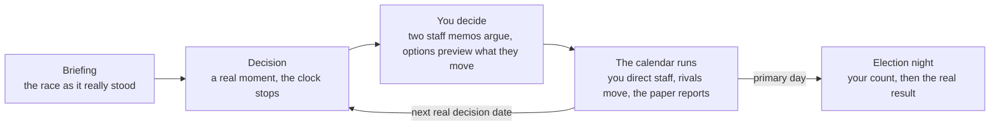

# Campaign Academy

**A political science learning tool that lets students run a real historical campaign in a simulation with AI staff.**

The first case is the 2013 Democratic primary for Mayor of New York. You run it from inside Bill de Blasio's campaign, which started in fourth place. The calendar runs. At the six moments where the real campaign had to decide something, the clock stops and you decide instead. Between decisions you direct a staff of live AI agents, the rival campaigns move against you, and a morning paper reports it all. On election night you see your result beside the certified one.

> **About this README (15 Nov 2026).** This is a working snapshot written to help make the demo video. It is not the final README (that is issue #56).
> - It describes `main` at `18bf5a8`.
> - It folds in every doc in the repo, plus the evals report (`docs/evals.md`).
> - Where a doc and the code disagree, the code on `main` wins.
>
> **Live site:** `campaign-academy.vercel.app` is stuck at `bbee564` (#67). Vercel's daily deploy limit blocked the later merges (#65, #68, #69, #70). A fresh deploy from Devank's Vercel account is under way; until then, demo from a local production build (see [Run it](#13-run-it)).

## Contents

1. [The pitch](#1-the-pitch)
2. [What the student does](#2-what-the-student-does)
3. [A tour of the app, screen by screen](#3-a-tour-of-the-app-screen-by-screen)
4. [The two-minute demo](#4-the-two-minute-demo)
5. [The AI: live agents, Gemini, iMessage](#5-the-ai-live-agents-gemini-imessage)
6. [Real and simulated, kept apart](#6-real-and-simulated-kept-apart)
7. [The case: the 2013 race](#7-the-case-the-2013-race)
8. [How accurate the simulation is](#8-how-accurate-the-simulation-is)
9. [Evals: do the agents decide as the real people did?](#9-evals-do-the-agents-decide-as-the-real-people-did)
10. [Testing](#10-testing)
11. [How it is built](#11-how-it-is-built)
12. [Who built what](#12-who-built-what)
13. [Run it](#13-run-it)
14. [Every doc in the repo](#14-every-doc-in-the-repo)
15. [Limits and open questions](#15-limits-and-open-questions)

---

## 1. The pitch

| | |
|---|---|
| **Who it is for** | Political science students who have never worked on a campaign |
| **Role** | Running a real campaign from the inside |
| **Material** | A real race: real candidates, polls, money, events and voters, every fact cited |
| **Setting** | New York City, on a real street map built from the city's open data |
| **Format** | A case: the real calendar, six real decision points, and a staff to direct in between |
| **How it ends** | Your simulated election night, district by district, then the real result beside it |
| **What you learn** | Delegating, budgeting, reading what different voter groups want, and weighing policy trade-offs |

**Flight-simulator version:** a flight simulator for political campaigns. You run a real race with AI staff, without knowing how it ends.

**Why it is different:**
- **The race is real.** The record is sourced and the simulation is fitted to it: the real campaign's choices with a typical staff routine land at 40.7–40.9% against the certified 40.81%.
- **The staff are live agents.** They plan, delegate to their own teams, spend real (simulated) money and report back.
- **No hindsight.** The agents only know what was known on the game's date.
- **You learn from the gap** between your choice and the real campaign's.

---

## 2. What the student does



1. **Briefing (27 January 2013).** The race on the day de Blasio launched: who is running, the rules (40% to win outright, else a runoff), the money and the polls. You start fourth.
2. **Decision.** A real moment, on its real date. The clock stops and a decision card opens.
   - The card shows what happened since your last decision, the situation, your money and days left.
   - Two of your directors each write a memo for a different option.
   - Each option shows its price and small up/down chips for what it will move.
3. **You decide.** You see **What changed** (poll, money and voter groups before and after), then **What the real campaign did**: "The same call you made" or "A different call". How it turned out for them is held back until the end.
4. **The calendar runs.**
   - Days pass, two seconds each at 1× (2× and 5× are faster).
   - You give orders to staff in plain English, send the candidate out on the map, add planks to the platform and set a weekly spending plan.
   - Rivals make their own moves.
   - Mornings with news pause the clock until you read the paper or put it aside.
5. **Election night (10 September 2013).** The count comes in across 65 Assembly Districts with a 40% line. Then the debrief shows your result, the certified result, and each decision against the record.

---

## 3. A tour of the app, screen by screen

This is a shot list. Everything here is on `main` today.

### The shell
- **Five tabs** across the top: **CASE · PROFILE · WAR ROOM · MAP · FACTIONS**, in black and gold with a sliding gold underline.
- **Top bar, left:**
  - **Spending** (red arrow), a hanging gold plate **Left to spend**, and **Income** (green arrow).
  - Each opens a panel with the **weekly plan sliders**: "Spend each week" and "Raise each week", each line with a count, a target, a runway warning and the next run date. Below them is a ledger of spending and income so far.
  - Numbers flash ± chips when they change.
- **Top bar, right:**
  - **The poll strip** (top three, "You" highlighted). It glows when a rival has done something you haven't seen.
  - Hover or click it for **The race so far** (a poll chart with decision markers) and **What your rivals are doing** (each move tagged Real data or Simulated).
  - **Clock:** play/pause, **Skip** ("to the next news or decision") and speed 1×/2×/5×. These are replaced by **Decision waiting** or **Paper waiting** when one is due.
  - Days left, the date and a progress bar.
- **Sidebar:**
  - **Tasks:** an editable checklist.
  - **Desk → Morning paper.**
  - A collapsible **Case outline**: titles stay hidden until you reach them.
  - The **⋯ Desk menu**: **Load demo start** (22 May 2013, Weiner enters), **Reset campaign**, and **Texts on my phone** (iMessage, see §5).
  - The campaign **saves itself** in the browser. Reload and it resumes with the clock paused; there is no save button.
- **Notifications** pop up bottom-left: staff speaking up on their own, results of orders and rival moves. Clicking a staff remark opens that person in the War room with their suggested order ready.

### Case
- Step pills (**Briefing, Decision 1–6, Debrief**), each locked until the clock reaches it. A **Your campaign now** strip shows poll, place, money and voter-group bars.
- **Briefing:** "The race on [date]" with four figures (you, the leader, days left, the 40% line), the candidates, and "How this works".
- **Decision:**
  - Date and skill, the title, "Since your last decision", the situation (cited, with Estimate tags), and "Platform on record".
  - **Your advisers:** two memo cards from your own staff, written live. The footer says they are simulated, not what anyone said in 2013. Clicking a card picks its option.
  - **What do you do?:** option cards with a price or "Free", what you'd have left, up/down chips, and "X recommends" badges. You can't choose an option you can no longer afford.
  - The sticky **Decide** bar.
  - Then **What changed** (animated before → after bars, with "See it on the map"), **What the real campaign did**, and "Carry on with the campaign" or "Give your staff work first".
  - The same card opens over any screen when the clock reaches a decision.
- **Debrief:** "Your election night", "What really happened" (certified shares and votes), "Your decisions against the record" (what followed, what was said afterwards), "Play it again", and the sources.

### Profile
- A photo card of de Blasio. **Platform** shows the cited record, your choices so far and the rivals' platforms.
- **Your additions** is the plank desk:
  - Type an idea and click **Shape it into a plank**. The Policy Director, or a staffer while that post is empty, drafts it with the voter groups it **serves** and **costs**.
  - Then **Adopt it** or **Discard**. You can add one plank between decisions.

### War room
- **A 3D stone chamber:**
  - "You" sit gilded on the dais, the directors on the step, their teams on the floor. The camera tilts slightly with the mouse.
  - **Click a figure** and the camera zooms onto that person and their team; **Whole room** or Esc resets it.
  - Lines glow and sparks run along them when work moves. Pops like "+$12k raised" or "−$25,000" appear on the figures.
- **Badge:** **Live agents**, or **Simulated staff · no API key**. Before the first order it reads "Staff are agents. Give an order to start."
- **Staff:**
  - Three posts are held by the real 2013 staff the record names, cited: Bill Hyers (Campaign Manager), Phil Walzak (Communications Director) and Jessica Singleton (Digital Director).
  - Invented staff fill out the team: Marcus Bell (Field Director), Dana Whitfield, Priya Nair, Rosa Delgado, Andre Baptiste, Ruth Feldman, Vincent Moretti, Carlos Vega, Hannah Brooks.
  - Three posts start empty: Policy Director, Data Director and Organizer, Bronx.
- **A person's panel:**
  - Good at, Weak at, Working on, Morale, and a live **Plan** checklist.
  - **Conversation**, with a collapsible **Thinking** timeline of the agent's reasoning, the report (spent, raised, actions), and asks for more money (Approve / Not now).
  - **Proposals:** priced option cards with **Do this**.
  - Delegation coaching: Strong/Workable/Weak, clarity out of 4, % right people.
  - The order box: "Tell X what you need…".
- **Dock:** Instruct, Reassign, Let go, Hire. The hiring panel shows candidates from the bench or **sourced by your agents**, with impact and spend-discipline meters.
- **Overview:** staff, vacancies, spent on jobs, the **Candidate's calendar**, direct reports and an activity feed.

### Map
- MapLibre with real streets, the 59 community districts, and 3D buildings when you fly in (right-drag to tilt).
- **Colour by:** Your support, Last decision (arrows and point labels), or a census group.
- **Click a district** for support, voter groups, "Who lives here" (census) and 311 requests.
- **Dock:** **Knock doors**, **Hold a rally**, **House party** (the candidate, two appearances a day, priced) and **Send staff**. Districts glow when work lands.
- **Election night:** the app switches to the Map by itself.
  - Districts count in one by one ("N of 65 reporting") with the 40% line, then the verdict.
  - Toggle **Your campaign / Your election night / Real result 2013** (Assembly Districts).

### Factions
- **22 voter groups** from the 2013 polls, drawn as circles sized by share of the electorate, under nine kinds (race, borough, ideology, religion, age, gender, income, education, labor).
- A circle is warm where you run ahead of your citywide figure, cool where you run behind.
- **22 links:** gold solid lines for "Agree", red dashed for "Opposed".
- **Click a group:** its linked groups arc around it with their reasons. The card shows the real Feb and Sep 2013 poll lines, what the group likely wants and doesn't want (inferred), and which of your planks serve or cost it.

### The morning paper, *The Five Borough Ledger*
- An old broadsheet in newsprint colours. The masthead has a countdown to the primary, the edition number and an **Archive** of past editions.
- **Simulated stories written by Gemini** (or Claude) under the masthead.
- **The lead story is from the record:** it's the real 2013 headline, paraphrased and cited, and its words ink in one by one beside a moving picture.
- **Answer the story:** three stances drafted by your communications staff, each showing which groups it wins (▲) and loses (▼), then **Put it out**. You can also **Hand it to Comms** or **Let it pass**, and a rubber stamp lands.
- Simulated **Your campaign** and **Your rivals** stories, a weekly **poll** box, "The stories moving the race" with illustrations (captioned as illustrations, no real people), and **letters to the editor** from voter groups.
- A corner notice ("Press to read. The clock waits.") pauses the clock.

---

## 4. The two-minute demo

The full click-by-click script, rehearsed on `main` with #64 and #65, is in [`docs/demo/judges-walkthrough.md`](docs/demo/judges-walkthrough.md).

**Setup:**
- Run a production build (`npm run build && npm run start` in `web/`) with `ANTHROPIC_API_KEY` and `GEMINI_API_KEY`, on a screen at least 1440 px wide.
- **Tab A:** `localhost:3000`, then **⋯ → Load demo start**. The War room badge must say **Live agents**.
- **Tab B:** `127.0.0.1:3000`, so it keeps its own save. Play it to election night and leave it on the Map.

| Time | What happens |
|---|---|
| 0:00 | Tab A, Case tab, 22 May 2013. The pitch: a real race, real record, AI staff. |
| 0:15 | Top bar: Weiner has entered with $4.8M; we're fourth at 9%. |
| 0:25 | War room: click **Marcus Bell** (Field Director); the camera zooms in. |
| 0:30 | Type `Canvass Black voters in Crown Heights and Flatbush this week, $25,000`, then Enter. |
| 0:35 | His reasoning streams under **Thinking**. He hands jobs to his team and a ring spins. |
| 0:50 | The report lands in about 15 s: money spent, Crown Heights +3, a notification. |
| 0:55 | **Morning paper**: the lead is the real 2013 headline; our stories are "written by Gemini". |
| 1:05 | Close it with ×. Click **Decision waiting**: what do we do about Weiner? |
| 1:10 | **Your advisers**: two directors argue opposite options, written live from our numbers. |
| 1:20 | Pick the Campaign Manager's card ("Spend early on name recognition"), then **Decide**. |
| 1:25 | **What changed**: poll 9% → 12%, money $4.3M → $3.6M. |
| 1:30 | **What the real campaign did**: *A different call: Leave him alone and stay on plan.* |
| 1:40 | Tab B, election night: the result card, then **Real result 2013** (de Blasio 40.8%, no runoff). |
| 1:55 | Close: "Run a real campaign with an AI staff, and see how your choices compare with history." |

**Tips:**
- Don't press Run or Skip in Tab A.
- Close the paper with ×: Esc both closes it and zooms the War room out.
- If an agent is slow, keep talking, or use **Do this** on a priced proposal (a few seconds).
- With no key, everything falls back to rules (about 3 s per order).
- Reset between judges with **⋯ → Load demo start** (10 s).

**The six real choices** (to play Tab B to the end): *break with Bloomberg*, *leave Weiner alone*, *join the hospital protest and accept arrest*, *hold everything for television*, *a family member introduces you* (the ad with his son), *make stop-and-frisk the second ad*. They usually land near 39–41%: a narrow win or a runoff against Thompson.

---

## 5. The AI: live agents, Gemini, iMessage

Every live part has a rules fallback, so the app always runs. With no key the War room says "Simulated staff · no API key".

### Staff: LangChain `deepagents` (LangChain track)
- **Each director is a `createDeepAgent`** (`web/src/lib/staff/agents.ts`) with its own team as subagents.
  - It plans with `write_todos` and hands work down with the `task` tool. The **Thinking** panel shows this live.
  - It keeps a memory file of what worked in this campaign (`/memory/AGENTS.md`), capped at 12 dated lines per post and cleared on restart.
  - **Models:** directors run on `claude-opus-5-5` (`DIRECTOR_MODEL`); the people under them are subagents on `claude-haiku-5-5` (`STAFF_MODEL`).
  - The deepagents file tools and general-purpose subagent are switched off. The custom tools are `take_action` (one engine action, with a `why` first), `send_report` and `propose` (2–3 priced options).
  - Each agent sees the campaign as the browser has it: date, cash under the cap, poll, weekly plan, calendar, platform, voter groups and every district's support, plus the action catalog with prices.
- **Actions are real engine actions.** An agent's tools call the same engine as everything else (`lib/engine/catalog.ts`, `resolve.ts`): canvass, rally, press pitch, mail, digital ads, call time, donor dinner, and so on. Each has a real cost and a simulated effect on districts and voter groups.
- **Order budgets:**
  - Each order gets its own budget, read from your order text, $80,000 by default.
  - One order can spend at most **$250,000** (#63, after the full test found one order spending $816,150), and never more than the campaign has.
  - A report can ask for more money ($5,000–$250,000), and you approve or refuse it.
- **No invented numbers.** A report quoting a figure nobody gave it is sent back once. After that, the offending sentence is dropped (`numbers.ts`).
- **No hindsight.** Every prompt says it's that date in 2013 and the agent knows nothing after it. A filter (`memo.ts`) drops any sentence from reports, thinking, remarks or memos that reaches past the date, such as "won the primary", "Mayor de Blasio", "September 10" or a year after 2013 (#63).
- **Follow-ups:** three campaign days after a report, the director comes back on their own with new proposals.
- **Unprompted remarks** (`lib/staff/speak.ts`):
  - Staff speak up when something needs your call: rival moves, money or the weekly plan running out, the weakest voter group or district, empty posts, idle staff, low morale.
  - They also speak up after each decision (with an order that carries it out) and on each new lead story.
  - Each remark comes with a suggested order. At most one every 3 days, and the same worry at most every 14.
- **Decision memos:**
  - Three days before each decision, two directors write live memos (on `claude-opus-5-5`) for two different options.
  - **Which option each argues for is assigned by fixed rotation, not by the model.** Left to choose, the model picked the real 2013 option at all six decisions.
  - A memo with hindsight or an invented figure is sent back once.
- **Questions vs orders:** asking a question spends nothing; an order spends money.
- **Hiring:** agents write a shortlist of three candidates for an empty post. Morale and "wrong person for the job" affect the work.
- **Rules fallback** (`offline.ts`): used with no key, when a live run fails before spending anything, or when the server can't be reached. It emits the same events, so the screens look the same.

### Rivals
- Quinn, Thompson, Liu and Weiner are agents too: a `createDeepAgent` each, with one tool, `make_move`, scored by the same engine (`lib/engine/rivalAgent.ts`, `lib/cases/rivals.ts`).
- After each of your decisions, every rival still in the race plans two moves on $150,000.
- A rival's gains fade as they near 4 points, and you lose half of what a rival gains.
- Real events still happen to them on their real dates.

### Platform planks
- `lib/manifesto/`: a staff agent turns your idea into a plank, naming the groups it serves and offends. That's the Policy Director when the post is filled (it starts empty), otherwise a staffer.
- Code sizes the effect: +1.5 in groups served, −2 in groups offended, at most ±0.4 citywide.
- With no key, a keyword match does it.

### The morning paper: Gemini (MLH Best Use of Gemini API, #52, #64)
- The simulated stories, the letters and the three **Answer the story** stances are written by **Gemini** (`gemini-3.8-flash`, `@google/genai`) through `lib/paper/model.ts`.
- If Gemini fails, Claude writes them. With neither key, the template stands.
- **Every story passes the same number check (`honest()`).** A story using a number that isn't in the facts is rejected, and its template stays.
- The masthead line names the writer. Checked on production: a live stances call came back `by: "gemini"` in 3.3 s.
- The lead story is always the real 2013 headline, cited. The model never writes it.

### Texts on your phone: Photon iMessage (#53, #68)
- **⋯ → Texts on my phone:** you text a code ("JOIN 4821") to the project's iMessage line, which links your phone.
- Then staff remarks arrive as iMessages, signed by the post, with "Reply YES to: …". Reply YES, or reply with your own order, and the report comes back as a threaded reply.
- iMessage touches: a 👍 tapback when an order lands, and a typing bubble while the staff work.
- Your number stays in your browser and never goes into the save.
- **Limits:** the reply inbox lives in one server's memory, so it suits the local demo, not Vercel. The routes don't check who's calling, so the Photon keys should not go on a public host yet (board note, 15 Nov).

### The weekly spending plan (#33, #70)
- Sliders in the top bar set how many of eight actions the campaign buys each week, and where each is aimed:
  - spending: doors, rallies, press, mail, digital ads;
  - income: call time, small donors, donor dinners.
- Every seventh day the clock spends the plan through the same engine path as a staff job, so it moves districts, groups and the poll, and the agents, rivals and paper all see it.
- **Side effects:**
  - Plan work spills a quarter into linked voter groups (the opposite way for opposed ones).
  - Donor pools asked every week give 20% less, compounding.
  - Each call-time session uses one of the candidate's two appearances that day.
- **Warnings:** a runway warning, and the Finance Director speaks up if the plan will run the money out.
- A new campaign starts on the default plan (one Brooklyn canvass, one call-time session and one press pitch a week), which is the routine the engine is fitted with.

---

## 6. Real and simulated, kept apart

| | The record | The simulation |
|---|---|---|
| **What it is** | What was true and what happened | What your choices and your staff's work do to your campaign |
| **Examples** | Polls, filings, results, the press, what staff said afterwards | Poll points gained, money spent, support in a voter group |
| **Where it comes from** | Sources, linked on every statement | Invented sizes, fitted to the record |
| **How it is shown** | Cited, tagged Real data | Tagged Simulated |

**Rules that keep it honest:**
- **Every statement of fact has a source.** Anything estimated is labelled as an estimate.
- **The tool never recommends.** Advice comes from your staff, in their own voices. The tool never says which option was best.
- **Previews show direction, not size.** You choose on judgment, then see what moved.
- **The real choice is shown only after you decide.** How it turned out for them is held to the end.
- **Decisions are never on a timer.**
- **The real choice is not always the right one.** Luck and rivals' mistakes are part of the record.
- **A real name is always sourced.** A real person appears in a post only where the record names them in it, and signs as the post. The rest of the staff are invented.
- **Poll numbers and inferences are kept apart.** Group sizes and poll lines are real. What a group likely values, and so which groups pull together or apart, is inferred and stored separately (`mayor2013-leanings.ts`, `mayor2013-links.ts`).
- **No leaks of the future to the agents.** The real choices (`taken`, `did`, `followed`, `saidAfter`) and the advisers on record (`advice`) never reach an agent prompt. Card lines that state things not yet known on the card's date are dropped for the evals.
- **Advisers on the record:** the three sourced 2013 advisers (John Del Cecato at two decisions, Bill Hyers at one) are kept in the data for the evals only. They're off the screen and never in a prompt; the "Your advisers" on screen are your own simulated staff.

---

## 7. The case: the 2013 race

From [`docs/research/2013-mayoral-primary.md`](docs/research/2013-mayoral-primary.md): 55 numbered sources, each claim marked VERIFIED, SNIPPET or UNVERIFIED.

**The race:**
- **Dates:** briefing 27 Jan 2013 (de Blasio's launch in Park Slope); primary 10 Sep 2013; 226 days apart.
- **Candidates:**
  - Bill de Blasio, Public Advocate.
  - Christine Quinn, Council Speaker, the front-runner at 35–37%.
  - Bill Thompson, former Comptroller and the 2009 nominee.
  - John Liu, Comptroller. He was denied matching funds on 5 Aug.
  - Anthony Weiner, who entered 22 May with $4.8M.
  - Sal Albanese and others.
- **Rules:**
  - 40% or a runoff (the runoff would have been 1 Oct).
  - Spending limit $6,426,000.
  - Public funds up to $3,534,300, matched $6 to $1 on the first $175.
  - Contribution limit $4,950.
- **Polls (Quinnipiac):**
  - 16 Jan: Quinn 35, de Blasio 11.
  - 15 Jul: Weiner 25, Quinn 22, Thompson 11, de Blasio 10.
  - 13 Aug: de Blasio 30.
  - 3 Sep: de Blasio 43, Thompson 20, Quinn 18.

**The six decisions in the game** (`web/src/lib/cases/mayor2013.ts`):

| # | Date | Title | Skill | The real choice |
|---|---|---|---|---|
| 1 | 27 Jan | What do you run as? | voter groups | A sharp break with Bloomberg: "a tale of two cities" |
| 2 | 22 May | A famous rival enters. What do you do about him? | delegating | Leave Weiner alone and stay on plan |
| 3 | 10 Jul | A hospital is closing and there is a protest today | policy | Join the protest and accept arrest (one of 15 arrested at Long Island College Hospital) |
| 4 | 15 Jul | Eight weeks left. How do you split the money? | budgeting | Hold everything for television |
| 5 | 8 Aug | Your first television ad | delegating | A family member introduces you (his 15-year-old son) |
| 6 | 19 Aug | The second ad, and whose voters you go after | voter groups | Make stop-and-frisk the second ad, contesting Thompson's base |

**Other key events:**
- 25 Apr: forum fight over Police Commissioner Kelly.
- 23 Jul: de Blasio calls on Weiner to quit.
- 12 Aug: Judge Scheindlin rules stop-and-frisk unconstitutional.
- 16 Sep: Thompson concedes; no runoff.
- 5 Nov: de Blasio wins the general election.

**Certified result** (Board of Elections, 30 Sep 2013; 691,801 votes):

| Candidate | Votes | Share |
|---|---|---|
| Bill de Blasio | 282,344 | 40.81% |
| William C. Thompson Jr. | 180,841 | 26.14% |
| Christine C. Quinn | 108,893 | 15.74% |
| John C. Liu | 47,286 | 6.84% |
| Anthony D. Weiner | 34,192 | 4.94% |
| Erick J. Salgado | 15,914 | 2.30% |
| Randy Credico | 11,530 | 1.67% |
| Sal F. Albanese | 5,843 | 0.84% |
| Neil V. Grimaldi | 4,677 | 0.68% |

- De Blasio cleared 40% by 0.81 points, about 5,600 votes. Earlier figures of 40.1–40.3% came from counts made before about 78,000 paper ballots were tallied.
- He was first in all five boroughs, best in Brooklyn (46.4%).

**The real staff:** campaign manager Bill Hyers; ad maker John Del Cecato (AKPD); communications director Phil Walzak; pollster GQR.

**The voters:** 22 groups with their February and September 2013 support, from two Marist poll tables, every number checked against the PDFs.

**Weak points the research names:**
- Decisions 2 and 3 rest partly on an NYT reconstruction that couldn't be opened.
- "No mail at all" is contested.
- There is no verified cash-on-hand figure at any decision.
- The split among Black voters in the exit poll is disputed.

**Why this race** ([`docs/research/case-shortlist.md`](docs/research/case-shortlist.md)): it has the best record, all four skills in one arc, and excellent finance data. The next cases on the shortlist are the 2021 mayoral primary (Garcia), the 2013 comptroller primary (Stringer), the 2018 NY-14 primary and the 2009 mayoral general (Thompson).

**Data** ([`docs/research/data-sources.md`](docs/research/data-sources.md)):
- NYC Board of Elections results by Assembly District.
- City Planning district shapes.
- NYC Campaign Finance Board data on NYC Open Data.
- Census ACS by PUMA.
- NYC Open Data for the street map and 311.
- **What can't be had for 2013:** results below Assembly District level, turnout rates, how any group voted, and where campaign money was aimed.

---

## 8. How accurate the simulation is

- **The case file is fitted to the record.** The real campaign's six choices, with the rivals acting (rules mode) and the default weekly plan, land within two points of the certified result for every candidate, with no runoff. Today every candidate lands within 0.2 points, and de Blasio finishes at 40.9 against the certified 40.81. `npm run check:engine` fails if that drifts.
- **You can lose.** The weakest choice at every decision, with no staff work, finishes third (de Blasio at 8.3%) and misses the runoff.
- **The student has to work.** The record alone finishes de Blasio on 39.5 and a runoff; with the rivals and no staff work, 37.1; with staff and no rivals, 43.1.
- **Deterministic:** the same inputs give the same world. The engine check also verifies that four Bronx canvasses a week move the Bronx, and that donor dinners cool liberal voters.
- **What it cannot do:** prove what a different choice would really have produced. It says so.

The tunable numbers (money scale, caps, rival budgets, plank sizes, spill, donor fatigue, speeds) are listed with their current values in [`web/README.md`](web/README.md#numbers-you-can-tune).

---

## 9. Evals: do the agents decide as the real people did?

We tested it with no student. A campaigner agent plays Bill de Blasio, and the staff, rivals and memos are the live agents. Each real person is played from verified research, knowing only what was true before each date. Their choices are compared with what the real people chose in 2013. The full report, with every run, is [`docs/evals.md`](docs/evals.md). Code in `web/src/lib/eval/`, run with `npm run eval` in `web/`; every run is saved in `web/eval/runs/` and traced in LangSmith.

**The catch: the model already knows this race.** Asked with no card at all what de Blasio's campaign did, it names the real choice at five of the six decisions. So plain agreement (about 90% on the cards) mostly measures memory. Hiding names didn't help: the model recognised the race on all but one masked card, and on every "twin" moved to an invented city, from the shape of the race alone.

**So we measured something memory can't fake: whether the choices follow the facts on the card.**

| Test | Result |
|---|---|
| Card rewritten so the facts point away from the 2013 choice: the agent moved | **78%** (28 of 36) |
| Control, same facts in other words: the agent kept its choice | **94%** (17 of 18) |
| Memory wrong, card given: still chose what really happened | **11 of 11** (all at the last decision, the second ad) |
| The whole campaign on its own, January to September | 6 of 6 real choices, 32 weekly staff meetings, 294 staff jobs |

Simulated vote share, as context only, since the engine is fitted to the real result: 42.4, against a certified 40.81.

What this shows:
- The agent follows evidence, not wording. It changes course when the facts change and holds when only the words change.
- Where its memory is wrong, the card carries it to the real choice. At the budget decision it's the other way round: memory knows the real answer every time, and the card leads the agent elsewhere.
- Memory still wins at the hospital protest. On rewritten cards the agent kept the 2013 choice, citing details the card never gave.

What it cannot show: that the agents would decide as these people did in a race the model has never read about. Two prompt changes aimed at grounding made no measurable difference. Eleven held-out decisions, written before any run and run once at the end, are reported in `docs/evals.md`.

---

## 10. Testing

**Automated checks** (in `web/`):

| Command | What it checks |
|---|---|
| `npx tsc --noEmit` and `npx eslint src scripts` | Types and lint |
| `npm run check:engine` | The real path lands on the certified result; the same inputs give the same world; every decision has a free option; the weakest play loses; the weekly plan moves the world |
| `npm run check:staff` | Orders and questions are told apart, a question spends nothing, and staff memory is capped |
| `npm run check:save` | A campaign comes back as it was, a bad save is refused, a reset leaves nothing, and loading is quiet (no stale notifications) |
| `npm run check:paper` | The paper's 15 prebuilt pictures: every 2013 story gets one, none repeats, and notes read as copy |
| `npm run check:memos` | Live decision memos (needs an API key): no part of the record leaks, and at most a third of memos land on the real choice |
| `npm run refit:case` | Not a check: refits the case's shifts after changing what staff or rival work is worth (it edits `mayor2013.ts`) |
| `npx next build` | The production build |

**The full test, 15 Nov** ([`docs/testing/2026-11-15-full-test.md`](docs/testing/2026-11-15-full-test.md)): Devank's test of `main` at `ad2089c` on dev, production and production with no key. Nothing crashed.

Scenarios:
- The real choices with light staff use: a runoff at 39.3%.
- A power user: an outright win at 40.0%.
- Hands off: out of the race at 9.3%.
- Chaos testing: all handled.
- No key: a runoff at 36.8%.
- The demo path: a runoff at 38.5%.

| # | Finding | Status |
|---|---|---|
| 1 | A director revealed how the real race ended | Fixed (#63) |
| 2 | "Simulated staff · no API key" after Load demo start on a live server | Fixed (#63) |
| 3 | One order spent $816,150 | Fixed (#63): $250,000 cap per order |
| 4 | "$0" read as no budget | Fixed (#63) |
| 5 | Agents saw two "budget left" figures | Fixed (#63) |
| 6 | Map header wraps one word per line at 1440 px | Open on `main` (a fix is committed on `ui`, not merged) |
| 7 | Real choices with light staff use give a runoff, not the outright win | By design: staff work matters |
| 8 | Rivals pile onto the student's best district | Open |
| 9–11 | With no key: an offensive or nonsense plank is accepted; an adviser's reason can contradict its option | Open (rules fallback only) |
| 12 | Poll chip runs together at 1440 px | Open |
| 13–18 | Small items: vague error for an order to an empty post, "Let go" greyed out with no reason, a new hire remembers the predecessor's work, etc. | Open |

**Fixed since the test:**
- Stale notifications on demo load (#65).
- Live agents failing on Vercel (#67, below).
- The test also recorded fixes from before it: campaigns no longer get stuck (#54), orders after a decision carry it out (#55), and advisers quote the card's numbers (#60).

**Speed:**
- A director order takes 10–24 s (four in parallel about 20 s).
- Memos arrive about 4 s after the demo loads.
- With no key, an order takes about 3 s.

**Not tested:** phone and tablet widths, a whole class at once, a connection dropped mid-order.

---

## 11. How it is built

**Stack:**
- Next.js 16.4.6 (App Router, Turbopack), React 19.3, TypeScript, Tailwind, `motion`, `zustand`.
- MapLibre 6 for the map.
- `deepagents` and `@langchain/anthropic` for the agents.
- `@google/genai` 2.32.0 for the paper, `@spectrum-ts/*` 12.14.0 for iMessage.
- Read [`web/AGENTS.md`](web/AGENTS.md) first: this Next.js version has breaking changes.

```
case file ──> simulate() ──┐
(lib/cases/mayor2013.ts)   ├──> the live world ──> every screen
work layer ────────────────┘    (worldNow, useCaseNow)
(staff jobs, weekly plan, candidate, planks, rivals)
        ^
        └── clock: one day at a time between decisions
```

1. **The case file is the data.** `lib/cases/mayor2013.ts` holds the race in the shape of `lib/cases/types.ts`. `simulate()` is pure: picks in, world out.
2. **The case store is the campaign** (`lib/cases/store.ts`): step, date, picks, work, bookings and the weekly plan.
3. **The work layer** holds everything done between decisions: staff jobs, plan spending, candidate appearances, planks and rival moves. Each is a `Work` entry folded in before `simulate()`.
4. **The clock** (`lib/cases/clock.ts`) moves one day at a time. It stops at decisions and pauses for the paper. Each day it spends the weekly plan, then the candidate's bookings.

The full map of files, API routes and tunable numbers is in [`web/README.md`](web/README.md).

**Deploying on Vercel:**
- `@langchain/langgraph-sdk` bundles five ES modules without a `package.json`, which Vercel's runtime loads as CommonJS. That made every agent route fail in production.
- `web/scripts/esm-scopes.mjs` runs on `postinstall` and marks them as modules, and `outputFileTracingIncludes` in `next.config.ts` ships those files (#67).

---

## 12. Who built what

Built by two people, each directing Claude Code agents. They coordinated on a GitHub issue board (#32; see [`docs/AGENT_COORDINATION.md`](docs/AGENT_COORDINATION.md)).

- **Devank Yadav:**
  - the engine and its fit to the record (#35, `check:engine`, headless runner);
  - the staff agents (#41: memory, live memos, number checks, order budgets);
  - the newspaper backend and Gemini (#27, #36, #52);
  - iMessage texting (#53);
  - save and resume, the demo start;
  - the full test and the judges' walkthrough.
- **Devaj Solanki:**
  - the interface (the 3D War room, the broadsheet paper, the map, the text pass);
  - the weekly spending plan (#33);
  - the evals (#28);
  - the case research and design.

**Sponsor tracks touched:**
- **LangChain:** deepagents staff, rivals and evals.
- **MLH Best Use of Gemini API:** the paper.
- **Photon:** iMessage.

---

## 13. Run it

```bash
cd web
npm install
cp .env.example .env.local
npm run dev
```

**Environment** (`web/.env.example`; all optional, and every missing key falls back to rules):

| Variable | For |
|---|---|
| `ANTHROPIC_API_KEY` | Staff, rivals, planks, memos; the paper's fallback |
| `GEMINI_API_KEY`, `GEMINI_MODEL` | The paper (default `gemini-3.8-flash`) |
| `SPECTRUM_PROJECT_ID`, `SPECTRUM_PROJECT_SECRET`, `SPECTRUM_IMESSAGE_LINE` | iMessage texts (local only for now) |
| `LANGSMITH_API_KEY` | Tracing the evals |

**For a demo, use a production build:** `npm run build && npm run start`. It serves on port 3000, faster and with no dev overlay.

In development, the browser console has `window.caseStore` and `window.game`.

---

## 14. Every doc in the repo

| Doc | What it is |
|---|---|
| [`web/README.md`](web/README.md) | How the code fits together: files, API routes, tunable numbers, the weekly plan, the engine fit |
| [`docs/demo/judges-walkthrough.md`](docs/demo/judges-walkthrough.md) | The rehearsed two-minute demo, click by click, with fallbacks and likely questions |
| [`docs/testing/2026-11-15-full-test.md`](docs/testing/2026-11-15-full-test.md) | The full test before the demo: six scenarios, 18 findings |
| [`docs/research/2013-mayoral-primary.md`](docs/research/2013-mayoral-primary.md) | The sourced research behind the case (55 sources) |
| [`docs/research/case-shortlist.md`](docs/research/case-shortlist.md) | Which races could be cases, and why 2013 first |
| [`docs/research/data-sources.md`](docs/research/data-sources.md) | Public data for real NYC races and what's missing |
| [`docs/plans/staff-agents.md`](docs/plans/staff-agents.md) | The staff agents plan agreed 15 Nov. Mostly built: real scheduling, per-order budgets, priced options, memory, follow-ups, live memos. Ordinary conversation was dropped |
| [`docs/plans/demo-polish.md`](docs/plans/demo-polish.md) | The demo-polish plan: poll chart, "What changed", War room rings, election-night bars, save and resume, demo start, reset. Built |
| [`docs/ui-text-pass.md`](docs/ui-text-pass.md) | The UI text pass: short versions with "Read more", type sizes |
| [`docs/AGENT_COORDINATION.md`](docs/AGENT_COORDINATION.md) | How the agents coordinate through GitHub issues and the board (#32) |
| `docs/evals.md` | The full evals report, summarised in §9 |

---

## 15. Limits and open questions

- **The record alone isn't the outright win.** With light staff use, the real choices give a narrow runoff, by design.
- **iMessage replies** need one long-running server. They don't work on serverless Vercel yet, and the routes need auth before the keys go public.
- **The rules fallback** (no key) accepts any plank text and can give an adviser a reason that contradicts its option.
- **Open questions:**
  - How strong staff work and rival moves should be next to the decisions (the sizes are first guesses).
  - Whether a student can replay the race from another campaign's side.
  - The intended user: high school or college, in class or solo.
- **More cases:** a case is a data file. Adding one means researching and writing one more file, not building more product.
