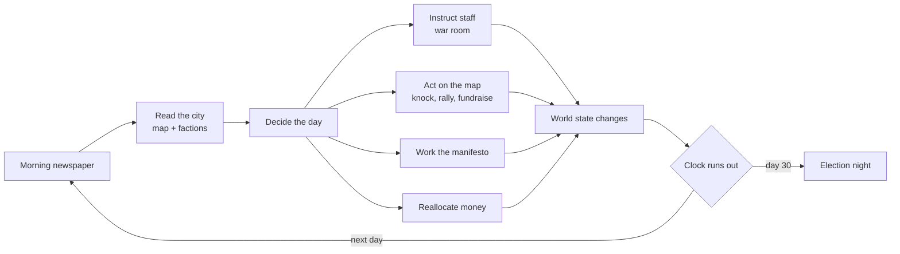
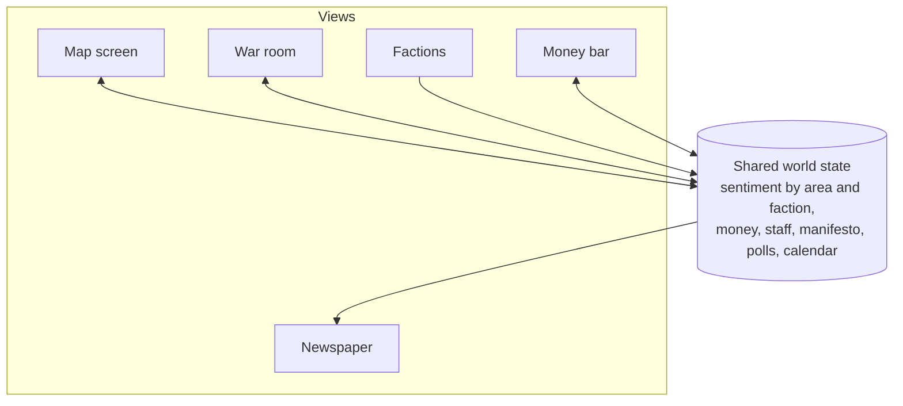
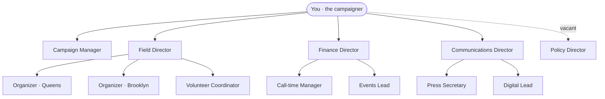
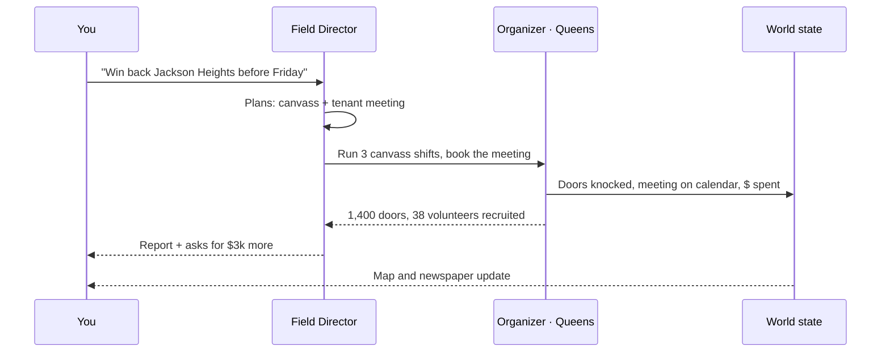
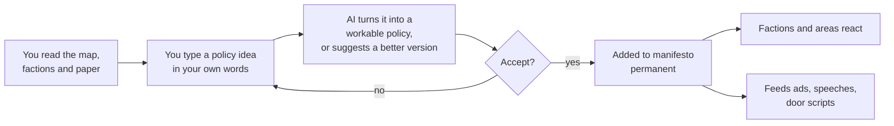

# Ballot to Bill

> Working title. "Capitol Classroom" is the other candidate name.

A real-time political war-room sim for students. You take over a live mayoral campaign in New York City thirty days before the election, run it day by day through your staff, your map, your money and your manifesto, and find out on election night whether you won.

This document is the idea hub. It holds the idea and nothing else: no research, no tech stack, no task plan. Those live in their own docs.

---

## 1. The idea in one page

| | |
|---|---|
| **Player** | A student who has never worked on a campaign |
| **Role** | The campaigner at the top of an existing campaign |
| **Setting** | New York City, on an accurate map built from the city's own open data |
| **Length** | 30 in-game days, each on a running clock |
| **What you do** | Direct staff, act on the map, spend and raise money, build a manifesto |
| **How it ends** | Election night: you win or lose the race |
| **What you learn** | How a campaign and policymaking actually work, and that running is possible |

**Design references**

- **Frostpunk** for the top resource bar, events, the faction view, and how a map can carry the state of a city. The map itself is a real data map, not game art.
- **The Nemesis system (Shadow of War)** for the war room: a visible hierarchy of characters you click into.
- **A software factory / agent swarm**, but political: you give direction at the top and real agents carry the work down the chain.

---

## 2. The core loop



Every action lands in one shared world state. The map, the war room, the factions view, the money bar and the newspaper are all different views of that same state, so anything you do on one screen shows up on the others.



---

## 3. Where you start: the candidate portfolio

You do not start from zero. You are handed a campaign that is already in motion.

- **A candidate with a record.** Past votes and positions that some people love and some people hold against them.
- **A team.** Several staff already hired, with gaps you will need to fill.
- **A map that already has opinions.** Areas that like you, areas that don't, areas up for grabs.
- **Money in the bank,** already flowing in and out.
- **A manifesto that is already started.**
- **Opponents** with their own strengths.

To the student it looks as though every player is dealt their own candidate, with their own stats, record and staff. The first build ships one hand-made candidate (section 11).

### Profile screen

The first thing you see, and reachable any time from the top bar.

```
┌──────────────────────────────────────────────────────────────────────┐
│  ┌──────────────┐   ADRIAN COLE                                      │
│  │              │   Council Member, Queens · running for Mayor       │
│  │   portrait   │                                                    │
│  │              │   Ideology    Pragmatic centre-left                │
│  │              │   Polling     31%  (2nd of 3)   ▲ 1 this week      │
│  │              │   Days left   30                                   │
│  └──────────────┘   Cash        $412,000                             │
│                                                                      │
│   RECORD                         WHERE YOU STAND                     │
│   ✓ Housing near transit         Strong   W. Queens, N. Brooklyn     │
│   ✓ Small-business rent relief   Weak     Staten Island, S. Brooklyn │
│   ✗ Voted against police cut     Open     Bronx, Upper Manhattan     │
│   ✓ Bus lane expansion                                               │
│                                                                      │
│   OPPONENTS        Victoria Hale 38%      Naomi Brandt 14%           │
│                                              [ Enter the war room ]  │
└──────────────────────────────────────────────────────────────────────┘
```

---

## 4. Time: days, a clock, and a newspaper

- The campaign runs for **30 days**.
- Each day runs on a **clock**. There are no turns and no "end turn" button.
- **Speed controls** let you slow the day down or speed it up. There is **no pause**: the campaign never stops.
- As the day nears its end, a **small visual reminder** appears so you can finish what you are doing.
- Each day has **assigned tasks**, and you can **add your own**. Tasks and events sit on a **calendar**.

### The morning newspaper

Each day opens with the paper. It is how events reach you, in the way Frostpunk delivers events, but written as news.

```
┌──────────────────────────────────────────────────────────────┐
│  THE FIVE BOROUGH LEDGER                 Day 12 · 18 to go   │
│ ─────────────────────────────────────────────────────────────│
│  SUBWAY DELAYS HIT QUEENS FOR THIRD DAY                      │
│  Riders in Jackson Heights and Flushing blame City Hall.     │
│  Transit riders are paying attention this week.              │
│                                                              │
│  HALE PROMISES 2,000 NEW OFFICERS      COLE RALLY DRAWS 900  │
│  Public-safety voters respond.         Field team credited.  │
│                                                              │
│  POLL            Hale 37 ▼1   Cole 33 ▲2   Brandt 14  —      │
│  WHO LIKES YOU   Renters ▲  Transit riders ▲  Homeowners ▼   │
└──────────────────────────────────────────────────────────────┘
```

It carries three things:

1. **What happened yesterday,** including the results of your own actions.
2. **New events** you may want to respond to.
3. **Stats on who likes you,** by faction and by area.

---

## 5. The shell: what is always on screen

Three main screens (war room, map, factions) share one frame.

```
┌────────────────────────────────────────────────────────────────────────┐
│ Profile │  LOSSES  ◄────  ( $412,000 )  ────►  GAINS  │ Day 12 14:20 ◂ 1× ▸│
├────────────────────────────────────────────────────────────────────────┤
│ ┌─────────────┐                                                        │
│ │ TASKS       │                                                        │
│ │ ☐ Rally, BX │              MAIN VIEW                                 │
│ │ ☐ Call time │      War room  ·  Map  ·  Factions                     │
│ │ + add task  │                                                        │
│ └─────────────┘                                                        │
│                                                                        │
├────────────────────────────────────────────────────────────────────────┤
│  ACTION PANEL  (optional, changes with the screen)                     │
└────────────────────────────────────────────────────────────────────────┘
```

- **Top bar:** profile, money, day and time, and the speed control (slower / faster, no pause).
- **Tasks panel:** today's tasks, top left, on every screen.
- **Main view:** one of the three screens.
- **Action panel:** bottom strip whose contents depend on the screen.

### Money: the only resource

Frostpunk puts temperature in the middle of its top bar. Here that spot holds **total cash**.

```
   LOSSES (spending)                 TOTAL                 GAINS (income)
 ┌───────────────────────┐      ┌───────────┐      ┌───────────────────────┐
 │ Staff      −$9,200/d  │      │           │      │ Small donors +$7,400/d│
 │ Ads        −$6,000/d  │ ◄─── │ $412,000  │ ───► │ Fundraisers  +$8,000/d│
 │ Field      −$4,100/d  │      │           │      │ Large donors +$3,000/d│
 │ Events     −$2,500/d  │      └───────────┘      └───────────────────────┘
 └───────────────────────┘
```

- **Left of the total:** where money is going, by category.
- **Right of the total:** where money is coming from, by category.
- **Hover a category** to see the exact line items inside it.
- **You can reallocate:** put more here, less there. Where that control lives (top bar or map screen) is still open.

---

## 6. Screen: the war room

The staff screen, laid out like the Nemesis hierarchy. You stand at the front; your direct reports stand behind you; their people stand behind them.



**How it works**

- **Click a direct report** to open them: who they are, what they are good at, what they are working on, and a place to give instructions in plain language.
- **Direct reports are real agents.** They plan, break your instruction into pieces, and hand those pieces to the people under them.
- **The people under them are smaller agents** that do one job each.
- **You can watch the work travel.** An instruction visibly moves down the hierarchy, and reports move back up.
- **The work is real in its result.** When it finishes, the shared world state changes: sentiment, money, polls, calendar.
- **Staff speak up unprompted.** From time to time someone brings you news, a warning, a request or an idea, not only when you click them.
- **You grow the team.** Empty slots can be filled, and who you hire and where you put them matters.



**What the student learns here:** how to delegate. Clear instructions to the right person get results. Vague instructions, or the right job handed to the wrong person, cost time and money.

**Action panel on this screen:** hire, reassign, message the selected staffer.

---

## 7. Screen: the map

An accurate map of New York City, built from the city's own open data. It should read as a real civic data map, not a game board: true district boundaries, real neighbourhood names, real streets and water underneath. The interface around it is our own design; the geography and the facts on it are real.

**What is real and what is simulated**

| Real (from NYC open data and the census) | Simulated (the game) |
|---|---|
| District and neighbourhood boundaries | How each area feels about your candidate |
| Who lives there: age, income, renters and owners, language | How factions are spread across areas |
| What residents are complaining about right now | Events, opponents, poll numbers |
| Past election results by area | The effect of your actions |

The simulated layer is always labelled as simulated.

The sketch below shows layout only; the real screen uses true boundaries.

```
┌──────────────────────────────────────────────────────────────┐
│                     ░░▒▒ BRONX ▒▒░░                          │
│            ▓▓                                                │
│          ▓▓▓▓  MANHATTAN      ▒▒▒▒▒▒ QUEENS ██████           │
│          ▓▓▓▓            ▒▒▒▒▒▒██████████████                │
│           ▓▓       ████████████▒▒▒▒▒▒▒▒                      │
│                  ██ BROOKLYN ████▒▒▒▒       ┌──────────────┐ │
│   ░░░░           ████▒▒▒▒░░░░░░             │ JACKSON HTS  │ │
│  ░ STATEN ░        ▒▒░░░░░░                 │ Support 58%  │ │
│   ░░░░░░                                    │ Top issue    │ │
│                                             │  Rent        │ │
│   ██ strong   ▒▒ open   ░░ weak             │ Recently     │ │
│                                             │  Subway delays│ │
│   View: [All] [Renters] [Seniors] [Unions]  └──────────────┘ │
└──────────────────────────────────────────────────────────────┘
```

**Sentiment**

- Each area is coloured by how it feels about you.
- A filter switches the map between **overall** sentiment and sentiment for **one faction**.
- The map reacts to events and to your actions.

**The information layer** (part of this screen, not a separate one)

Click or hover an area to see information about it. It is presented as facts you read, not as advice:

- Who lives there (real demographic data).
- Its main problems (drawn from what residents of that district actually report to the city).
- What happened there recently.
- How it feels about you and why.

**Acting on the map**

Click an area to do things there. These go onto the calendar:

- **Door knocking**
- **Rallies and appearances**
- **Fundraisers**

**Action panel on this screen:** the actions available for the selected area, with cost and time.

---

## 8. Screen: factions

A whiteboard-style canvas of circles. Each circle is a group of voters. **Bigger groups get bigger circles.**

```
        ┌────────────────────────────────────────────────────┐
        │        ◯ Students                                  │
        │                    ⬤⬤⬤                             │
        │    ⬤⬤              ⬤⬤⬤⬤  Renters        ⬤⬤⬤⬤      │
        │   ⬤⬤⬤ Unions       ⬤⬤⬤                 ⬤⬤⬤⬤⬤     │
        │    ⬤⬤                                   ⬤⬤⬤⬤ Home-│
        │              ◯ Donors      ⬤⬤                owners│
        │   ⬤⬤⬤                     ⬤⬤ Small biz            │
        │  ⬤⬤⬤⬤ Immigrant                                    │
        │   ⬤⬤⬤  communities                                 │
        └────────────────────────────────────────────────────┘
```

Click a circle to read about that faction:

```
┌───────────────────────────────────────────────────────────┐
│  RENTERS                              feels: warm toward you│
│                                                           │
│  Two in three New Yorkers rent. This group is young,      │
│  spread across every borough, and votes when it believes  │
│  rent is on the ballot.                                   │
│                                                           │
│  VALUES     Stable rents. More housing. Tenant protection.│
│  DISLIKES   Luxury-only development. Landlord tax breaks. │
└───────────────────────────────────────────────────────────┘
```

- **A paragraph** on who they are and what they want.
- **What they value** and **what they dislike**, written as sentences.
- **Read-only.** Unlike Frostpunk, you cannot change a faction from this screen. You read it, then use what you learned to write better policy and choose better actions.
- Circle colour can show how the faction currently feels about you.

Factions are groups of people defined by interest, identity or ideology, for example renters, homeowners, union members, immigrant communities, small-business owners, wealthy donors.

---

## 9. The manifesto

Policy is not a separate mini-game. It lives in one document: your manifesto.



- **It does not start empty.** The candidate arrives with a few planks from their record.
- **You open by building it out** to around five policies, once you have read the profile, the opponents and the city.
- **Every few days you add more,** as new data and events come in.
- **You do not write final policy text.** You type what you want; AI returns a suggested or modified version that is concrete and realistic, and shows who it will please and anger.
- **Nothing can be removed.** Once a plank is in, you own it for the rest of the race.
- **It drives your messaging.** Marketing, speeches and door scripts draw on what is in the manifesto.
- **It is daily work,** alongside directing staff and acting on the map, not a separate phase.

**What the student learns here:** how a vague wish becomes a policy, that every policy has winners and losers, and that promises are permanent.

---

## 10. Politics, tactics and the ending

**Politics**

- **No real people.** Every candidate, staffer and journalist is fictional.
- **Real ideologies.** Left, right, and named ideologies such as socialism or conservatism appear as labels on candidates and factions.
- **No side is favoured.** The same rules apply whatever your candidate believes.

**Tactics and risk**

- Honest tactics and deceptive tactics are both available.
- Deceptive tactics can pay off.
- Each one shows a **risk factor before you commit**, and that number decides whether it backfires.
- A backfire is public: it reaches the newspaper, moves factions against you, and can cost staff.

```
┌────────────────────────────────────────────────────┐
│  MISLEADING MAILER ON HALE'S TAX RECORD            │
│  Cost $8,000          Could gain  +3 with seniors  │
│  Risk of backfire  ████████░░  78%                 │
│  If exposed: front-page story, −6 with seniors,    │
│  Press Secretary may resign                        │
│                       [ Do it ]   [ Don't ]        │
└────────────────────────────────────────────────────┘
```

**Election night**

Day 30 ends in a results screen: the map fills in area by area, the vote totals come in, and you win or lose. This is the last step of the whole game.

---

## 11. The first candidate: Adrian Cole

The one hand-made candidate in the first build. Fictional.

**Who he is**

- Two-term City Council member from western Queens, running for Mayor.
- Son of a bus mechanic and a school aide; former tenant organiser, then a small-business loan officer.
- **Ideology:** pragmatic centre-left. Progressive on housing and transit, moderate on public safety, friendly to small business.
- **Why him:** he is cross-pressured. Nobody is fully happy with him, so every choice has a visible cost.

**His record**

| Past position | Who liked it | Who didn't |
|---|---|---|
| Voted for new housing near subway stations | Renters, students | Low-density homeowners |
| Wrote small-business rent relief | Small-business owners, immigrant communities | Real-estate donors |
| Voted against cutting the police budget | Seniors, public-safety voters | Young progressives |
| Backed bus lane expansion | Transit riders | Drivers, some merchants |
| Took union endorsements, skipped a strike picket | Nobody fully | Union members are lukewarm |

**The race on day 1**

| Candidate | Ideology | Poll | Strength |
|---|---|---|---|
| Victoria Hale | Centre-right, law-and-order, pro-business | 38% | Money, homeowners, Staten Island |
| **Adrian Cole** | Pragmatic centre-left | 31% | Renters, western Queens |
| Naomi Brandt | Democratic socialist insurgent | 14% | Young progressives, students |
| Undecided | | 17% | |

**The map on day 1**

- **Strong:** western Queens, north Brooklyn.
- **Weak:** Staten Island, southern Brooklyn, Upper East Side.
- **Open:** the Bronx, Upper Manhattan, southeast Queens.

**Factions on day 1**

| Faction | Size | Feels about Cole | Why |
|---|---|---|---|
| Renters | Very large | Warm | Housing vote |
| Immigrant communities | Large | Warm | Rent relief, his district |
| Transit riders | Large | Warm | Bus lanes |
| Homeowners | Large | Cold | Housing near transit |
| Seniors | Large | Mixed | Like the police vote, distrust change |
| Union members | Medium | Lukewarm | Missed the picket |
| Small-business owners | Medium | Warm | Rent relief |
| Young progressives | Medium | Cool | Police vote; prefer Brandt |
| Wealthy donors and real estate | Small, rich | Cold | Prefer Hale |
| Students | Small | Mixed | Split with Brandt |

**Money on day 1**

- $412,000 in the bank.
- Raising about $18,000 a day, spending about $22,000. He is burning cash.

**Team on day 1**

| Role | Name | Good at | Weak at |
|---|---|---|---|
| Campaign Manager | Priya Nair | Planning, keeping people on task | Cautious, slow on risk |
| Field Director | Marcus Bell | Volunteers, door programs | Overspends |
| Finance Director | Dana Whitfield | Large donors | Dismissive of small-dollar |
| Communications Director | Leo Santos | Press, rapid response | Tempted by risky tactics |
| Policy Director | *vacant* | | First hire to make |
| Data Director | *vacant* | | Second hire to make |

Under them: borough organizers for Queens and Brooklyn (none yet for the Bronx), a volunteer coordinator, a call-time manager, an events lead, a press secretary and a digital lead.

**Manifesto on day 1**

1. Build housing near every subway station.
2. Extend small-business rent relief citywide.
3. Keep police headcount level; add mental-health response teams.

The player's first job is to take this to five.

**Opening problems for the player**

- Brandt is taking the left; Hale is taking the centre. Which do you chase?
- Money runs out before day 30 at the current burn.
- No organizer in the Bronx, the biggest open area.
- Unions have not endorsed.

---

## 12. Open questions

- Where the money-reallocation control lives: top bar or map screen.
- How fine the map is: the 59 community districts, or the smaller neighbourhood areas inside them.
- How many speed steps the clock has.
- Whether opponents act on their own each day or only through newspaper events.
- Whether parties are named or candidates carry ideology labels only.
- How long one in-game day lasts in real time.
- The final name.
