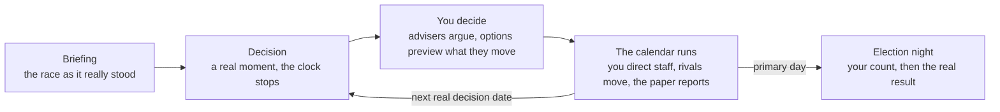

# Campaign Academy

A campaign simulation for students, built on real races. You take over a real New York City campaign at a real moment, with the real candidates, money, polls and voters of that year. The calendar runs. At the points where that campaign had to decide something, the clock stops and you decide instead. Between decisions you direct the campaign's staff, and the other candidates campaign against you. At the end you see how your version finished and what really happened.

This document is the idea hub. It holds the idea and nothing else: no research, no tech stack, no task plan. Research is in `docs/research/`. How the code is put together is in `web/README.md`.

---

## 1. The idea in one page

| | |
|---|---|
| **Student** | Someone who has never worked on a campaign |
| **Role** | Running a real campaign from the inside |
| **Material** | Real races, real candidates, real data from the period |
| **Setting** | New York City, on an accurate map built from the city's own open data |
| **Format** | A case: a real calendar with four to six real decision points, and staff to direct in between |
| **How it ends** | Your simulated election night, district by district, then the real one beside it |
| **What you learn** | How to delegate, budget, read what different groups of voters want and weigh policy trade-offs |

**What changed.** The first version was a simulation of a fictional candidate in an invented race. This version keeps the simulation and replaces everything it stands on: the people, the situation at each decision, the money and the electorate are taken from the record.

---

## 2. The loop

1. **Briefing.** The race on a real date: who is running, the rules, the money, the polls.
2. **Decision.** A real moment the campaign faced, on its real date. The clock stops and a decision card opens. What the world did since your last decision is real: rivals enter, scandals break, courts rule.
3. **You decide.** The campaign's advisers argue for different options. Each option shows a small preview of what it will move, up or down, and nothing more. Once you have chosen you see what the real campaign did at that point.
4. **The calendar runs.** Days pass towards the next decision. You give the staff work in plain language and they plan it, hand it down and report back. You can send the candidate out in person, and add planks to the platform. The other candidates make moves of their own. On mornings with news the clock pauses and the paper's notice glows until you read it or put it aside.
5. **Election night.** On primary day the count comes in across the city's Assembly Districts. Then the debrief: your result against the threshold you needed, the certified real result, and, decision by decision, how the real campaign's choices turned out.

---

## 3. Two layers, kept apart

| | The record | The simulation |
|---|---|---|
| **What it is** | What was true and what happened | What your choices and your staff's work do to your campaign |
| **Examples** | Polls, filings, results, what staff said afterwards | Poll points gained, money spent, support in a voter group |
| **Where it comes from** | Sources, linked on every statement | Invented sizes, fitted to the record |
| **How it is shown** | Marked as real data | Marked as simulated |

The simulation is grounded in the record and is not a replay of it. The six decisions are fitted so that the real campaign's own choices finish close to the real result. On top of that, your staff's work and your rivals' moves push the race either way, so the same choices can end differently. It cannot prove what a different choice would have produced, and it says so.

---

## 4. Rules that keep it honest

- **Every statement of fact has a source.** Anything estimated is labelled as an estimate.
- **The tool never recommends.** Advice comes from the advisers, in their own voices. The tool does not say which option was best, before or after.
- **Previews show direction, not size.** You choose on judgment, then see what moved.
- **The real campaign's choice is shown only after you decide.** Once you have chosen, you see what they did at that point. How it turned out for them is held to the end, so later events are not spoiled.
- **Decisions are never on a timer.** The clock stops at a decision and stays stopped until you choose.
- **The real choice is not always the right one.** Luck and rivals' mistakes are part of the record and are shown as such.
- **A real name is always sourced.** A real person appears in a post only where the record names them in it, and the War room cites that source. The rest of the staff are invented people, so the student has a full team to direct.
- **Poll numbers and inferences are kept apart.** How large a voter group is and how it polled are real figures. What a group is likely to value, and so which groups pull together or apart, is inferred and stored separately. The Factions screen is the one place that shows real, simulated and inferred figures side by side without tags.
- **Cases are chosen for the lesson.** Not for who won or what they believed. Party primaries are preferred because the contest is inside one party.

---

## 5. The people

**Advisers.** At each decision the campaign's staff argue for different options.

- **On the record.** Where a staff member is documented as arguing for something, the adviser says that, with the source.
- **Predicted.** Where the record is silent, the adviser's argument is written from that person's role and documented background, and is labelled as predicted and not a quotation.

Delegation is taught here: whose judgment you weigh for which kind of decision, and whether you can tell a strong argument from a confident one.

**Staff.** Between decisions the same campaign is a team you direct. Each director is a live AI agent that plans the work you ask for and hands jobs to its own people, who are agents too. They report back what was done, what it cost, and how clear your instruction was. They also speak up unprompted when something needs your attention.

**Rivals.** The other candidates are the real ones, starting from their real standing. Each is a live AI agent that makes campaign moves in response to yours. Real events still happen to them on their real dates.

---

## 6. What a case holds

| Part | Contents |
|---|---|
| **The race** | Office, date, candidates, rules, the certified result |
| **The campaign you run** | The candidate, their platform as it stood on each date, their staff |
| **The starting state** | Money, poll standing and voter-group support at the briefing date, with what each number rests on |
| **Decision points** | For each: what the world did since the last one, the situation, the options with their previews and effects, the advisers, and the record of what the real campaign did, what followed and what was said afterwards |
| **The press** | What was reported, by date, paraphrased and cited |
| **The voters** | The groups the period's polls reported, with each group's size and how it polled |
| **The city then** | The certified result by district, and demographics |
| **Sources** | Every document, dataset and article the case rests on |

A case is a data file. Adding a case means researching and writing one more file, not building more product.

---

## 7. The screens

| Screen | Shows |
|---|---|
| **Case** | The briefing, each decision you have reached, and the debrief |
| **Profile** | The real candidate and race as of your date: record, platform (each plank dated and cited), and the planks you add |
| **War room** | The campaign's staff. You give orders in plain language and watch the work travel down and back |
| **Map** | The city: where your campaign is stronger or weaker, which districts your last decision moved, the candidate's own appearances, and on primary day the count as it comes in |
| **Factions** | The voter groups the polls reported: how large each is, where you stand with it, what it is likely to want, and which groups pull together or against each other |

The top bar holds the money (spent, left under the cap, raised), the poll, the date and the clock. Hovering the poll lists what each rival is doing, and it glows when one of them has done something you have not read. The morning paper opens from the sidebar. On a morning with news the clock pauses and a notice glows in the corner until you open the paper or put it aside.

---

## 8. The cases

One deep case first, then four that each add a different lesson. The shortlist and the reasons for each choice are in `docs/research/`.

**First case:** the 2013 Democratic primary for Mayor of New York, run from inside the campaign that started in fourth place.

---

## 9. Do the agents decide as the real people did?

We tested it with no student. A campaigner agent plays Bill de Blasio, and the staff, rivals and memos are the live agents. Each real person is played from verified research, knowing only what was true before each date. Their choices are compared with what the real people chose in 2013. The full report, with every run, is `docs/evals.md`.

**The catch: the model already knows this race.** Asked with no card at all what de Blasio's campaign did, it names the real choice at five of the six decisions. So plain agreement (about 90% on the cards) mostly measures memory. Hiding names didn't help: the model recognised the race on all but one masked card, and on every "twin" moved to an invented city, from the shape of the race alone.

**So we measured something memory can't fake: whether the choices follow the facts on the card.**

| Test | Result |
|---|---|
| Card rewritten so the facts point away from the 2013 choice: the agent moved | **78%** (28 of 36) |
| Control, same facts in other words: the agent kept its choice | **94%** (17 of 18) |
| Memory wrong, card given: still chose what really happened | **11 of 11** (all at the last decision, the second ad) |
| The whole campaign on its own, January to September | 6 of 6 real choices, 32 weekly staff meetings, 294 staff jobs |

Simulated vote share, as context only, since the engine is fitted to the real result: 42.4, against a certified 40.81.

What this shows:
- The agent follows evidence, not wording. It changes course when the facts change and holds when only the words change.
- Where its memory is wrong, the card carries it to the real choice. At the budget decision it's the other way round: memory knows the real answer every time, and the card leads the agent elsewhere.
- Memory still wins at the hospital protest. On rewritten cards the agent kept the 2013 choice, citing details the card never gave.

What it cannot show: that the agents would decide as these people did in a race the model has never read about. Two prompt changes aimed at grounding made no measurable difference. Eleven held-out decisions, written before any run and run once at the end, are reported in `docs/evals.md`.

---

## 10. Open questions

- How strong staff work and rival moves should be next to the decisions. The current sizes are first guesses.
- Whether the student can replay the same race from another campaign's side.
- The named user: high school or college, in class or solo.
