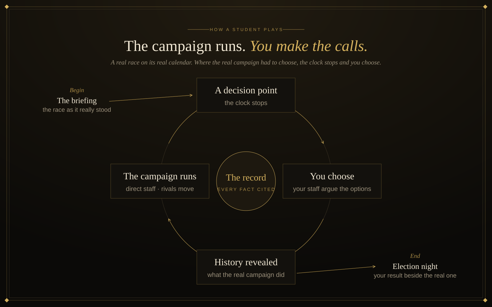
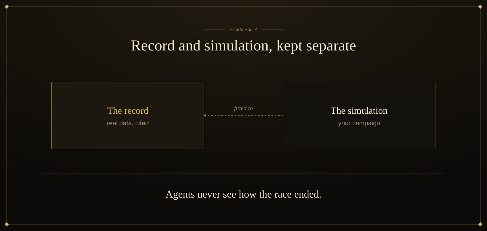

<!-- PROPOSED README (draft). The full, unchanged README is README.md; every detail there still holds.
     Figures: docs/readme/diagrams (rebuild with `node docs/readme/diagrams/build.mjs`). Screens: docs/readme/screens. -->

<h1 align="center">Campaign Academy</h1>

<p align="center"><b>A learning tool for political science students to simulate real campaigns.</b></p>

<p align="center">Students run a real race from the inside, with live LangChain deep agents that play the people in it, grounded in the historical record.</p>

<p align="center">
LangChain deep agents · Claude Opus, Sonnet and Haiku · Gemini · LangSmith · Photon iMessage · Next.js · MapLibre
</p>

<p align="center"></p>
<p align="center"><sub><b>The War room, during a live order.</b> The field director has split the order between two organizers; each agent's reasoning streams on the right as it happens.</sub></p>

---

## The problem

Political science students learn campaigns from the outside: readings, polls, case write-ups, all written after the result is known. They never have to make the calls themselves: how to spend a limited budget, which voters to go after, what to tell a team, how to answer a rival's move. And once you know how a race ended, every choice in it looks obvious.

## The idea

Put the student inside a **real** race, on its **real** calendar, without telling them how it ends. Give them a staff to direct, rivals who fight back and a press that reports it all. At the end, show them their result beside the real one, so they learn from the gap.

## The solution

Campaign Academy turns a real race into a **case**: a sourced record of the candidates, polls, money, events and voters, plus the moments where the real campaign had to decide.

- **The race is real.** Every fact on screen is cited. The simulation is fitted to the record, so playing the real choices lands on the real result.
- **The people are live agents.** Your staff and your rivals are LangChain deep agents. Directors plan, hand jobs to their own teams, spend simulated money through the simulation engine and report back. Rivals plan their own moves.
- **No hindsight.** The agents know only what was known on the campaign's date, and a filter drops anything that leaks the future.
- **You learn from the gap.** After each decision you see what the real campaign did. How it turned out for them is held back to the end.

**A new race is new data, not new code.** We built one case: the 2013 Democratic primary for Mayor of New York, run from inside Bill de Blasio's campaign.

---

## How it works

<p align="center"></p>

1. **The briefing.** The race as it really stood when the campaign began.
2. **A decision point.** On a real date, the clock stops. Two of your own staff each argue for a different option; each option shows its price and which way it moves things.
3. **History revealed.** After you choose, you see what changed and what the real campaign did.
4. **The campaign runs.** Between decisions you direct your staff in plain English, send the candidate out on the map and set a weekly spending plan. Rivals make their own moves, and a morning paper reports it all.
5. **Election night.** The count comes in district by district, then the real result appears beside yours.

<p align="center"></p>
<p align="center"><sub><b>A decision point, from the first case.</b> Every line is cited to its source.</sub></p>

## Inside the app

| Screen | What the student does there |
|---|---|
| **Case** | Reads the briefing, makes the six decisions, sees what the real campaign did |
| **War room** | Gives orders to live staff agents, hires and lets people go, approves money asks |
| **Map** | Real New York streets and 59 districts; sends the candidate to knock doors, rally or host a house party |
| **Factions** | 22 voter groups from the 2013 polls, and which groups pull together or apart |
| **Morning paper** | The real headline each morning, cited; answers the story with a stance from the comms team |
| **Top bar** | Money left, the polls, the rivals' moves and a weekly spending plan |

<p align="center"></p>
<p align="center"><sub><b>The morning paper.</b> The lead is the real 2013 headline, paraphrased and cited. The rest of the paper is simulated, and you can answer the story.</sub></p>

---

## How it is built

<p align="center"></p>

The campaign lives in the browser: the case file, the daily clock and a pure simulation engine (`simulate()`: decisions and work in, campaign state out). The agents run on the server behind Next.js API routes. Each request carries a snapshot of the campaign, and the server keeps nothing between requests. Every live part has a rules fallback that emits the same events, so the tool runs even with no API key.

<p align="center"></p>

One order, step by step:

1. **Instruction.** The student writes to one director in plain language. The order's budget is read from the text ($80,000 by default, at most $250,000, never more than the campaign has).
2. **Context.** The browser sends the director a snapshot of the campaign: the date, cash, polls, calendar, platform, voter groups and support in every district. The director's memory file (`/memory/AGENTS.md`, up to 12 lines from earlier orders) and the action catalog with prices are added.
3. **Director.** A deep agent on Claude Opus plans the order, splits it into jobs and gives each one, through the `task` tool, to the person on its team whose strengths fit.
4. **Team.** Each team member is a subagent on Claude Haiku with its own prompt and voice. It sees only its brief and acts through one tool, `take_action`, writing its reason before its choice. Independent jobs run in parallel.
5. **Engine.** Every action goes through the same engine as the rest of the simulation, which prices it, refuses it if the order's budget is spent, and moves support in districts and voter groups.
6. **Report and guards.** The director closes the order with `send_report`. A figure the agent was never shown is sent back once, then cut; any sentence that reaches past the campaign's date is removed. The memory file records the order.
7. **Live view.** Every step is streamed to the War room as it happens: the student watches each agent's reasoning, sees the hand-offs drawn between director and team, and gets the report with a grade for how well the order was delegated.

No model ever sets a poll figure, a cost or an effect.

## Honest by design

<p align="center"></p>

- Every statement of fact has a source; anything estimated says so.
- The tool never recommends. Advice comes only from your staff.
- The real choice is shown only after you decide, and it is not always the right one.
- A real person appears in a post only where the record names them in it. The rest of the staff are invented.

## Does it work?

<p align="center"></p>

**The simulation is fitted (first case).** The real campaign's six choices, with the rivals acting and a typical weekly plan, land every candidate within 0.2 points of the certified result. Play the weakest choices with no staff work and you finish third.

<p align="center"></p>

**Do the agents decide as the real people did?** We tested it with no student: an agent plays de Blasio, the live agents play everyone else, and each sees only facts dated before the decision. However, the model already knows this race, so plain agreement mostly measures memory. What memory can't fake is whether the choices follow the facts on the card:

- **They follow evidence, not wording.** Rewrite the facts to point away from the 2013 choice and the agent moves 78% of the time; reword the same facts and it holds 94% of the time.
- **On 11 held-out decisions it was never tuned on, the card adds almost nothing to memory** (70% against 67%).

The honest summary: the agents are grounded in the evidence they are given, but they don't reproduce real choices beyond what the model already remembers. The full method and all seven runs are in [README §9](README.md#9-evals-do-the-agents-decide-as-the-real-people-did).

---

## Validation

Devank wrote to about 60 political science professors and students while we built it. Six replied, and three students tried the tool during the hackathon.

**Prof. Samuel S.-H. Wang** (Princeton Neuroscience Institute, founder of the Princeton Election Consortium) replied with two points to be careful about:

- **Paid media is the big unknown.** How effective advertising is remains uncertain, and issue positions may matter less than people expect.
- **Budgeting matters,** because different kinds of campaign material cost different amounts.

What we do with that: every action in the simulation has its own price, from door knocking to television, and the student sets a weekly spending plan across doors, rallies, press, mail and digital ads. How much each kind of spending moves voters is fitted to the record of the race, not measured, and the tool says so.

---

## Tracks

### Education (main track)

Campaign Academy is built around how case-method teaching works, with the decision made by the student instead of read about:

- **Real material, cited.** Every fact links to its source, so a class can check it and argue with it.
- **Judgment before feedback.** Options preview only the direction of an effect, not its size. The student chooses, then sees what moved, then what the real campaign did.
- **Four skills a course can assess:** delegating (each order is graded on clarity and on giving the job to the right people), budgeting, reading voter groups and weighing policy trade-offs.
- **No answer key.** The tool never says which option was best, and the real choice is not always the right one.
- **More cases are data, not code.** A new race is one researched case file.

### LangChain: deep agents and LangSmith

Every live staff member is a LangChain **deep agent** (`deepagents` 1.16.5):

| Agent | What it uses |
|---|---|
| **Staff director**, one per post | `createDeepAgent` with its team as subagents through the `task` tool, run in parallel; a `/memory/AGENTS.md` memory file per post; custom tools `take_action`, `send_report`, `propose` |
| **Staff under a director** | `SubAgent` specs, each with its own model (Haiku 5.5), its own voice and one tool |
| **Rival campaigns** ×4 | `createDeepAgent` with one tool, `make_move`, scored by the same engine |
| **End-of-election debrief** | `write_todos`, a read-only virtual filesystem of the whole campaign and the sourced record, seven subagents in parallel |
| **Evals campaigner** | Read tools and one `decide` tool; every run traced in **LangSmith** (project `campaign-academy-evals`) |

The War room's **Thinking** panel streams the agents' reasoning and hand-offs as they happen. We say plainly what isn't built: the staff director doesn't have `write_todos` yet, there is no checkpointer, and staff traces aren't flushed on Vercel. The full account, with every limit we found, is in [README §5b](README.md#5b-how-the-agents-work-langchain-deep-agents-in-depth).

### Amazon: Best Practical AI Innovation

An AI-powered tool a political science student would use every week of a course, built around the track's focus areas:

- **Agentic behavior.** Staff directors are deep agents that plan an order, split it into jobs, hand them to subagents and act through tools, over many steps (Figure 3). Rival campaigns plan and act on their own.
- **Real-world impact.** Students learn campaigns from readings written after the result. Here they make the calls on a real race, with every fact cited, and compare themselves with what really happened.
- **Adaptive intelligence.** Each director keeps a memory of what worked in this campaign and comes back with follow-ups. Staff speak up when money runs low, a voter group slips or a rival moves. Every order is graded on how well it was delegated.
- **User-friendly design.** Orders are plain language; the agents' reasoning is shown live; every number says whether it is real or simulated.
- **Reliable.** Every live part has a rules fallback, so the tool runs even with no API key, and an automated check keeps the simulation on the real result.

### Peri: Forward Deployed Challenge

| | |
|---|---|
| **Organization** | Princeton University |
| **Person consulted** | Prof. Samuel S.-H. Wang, Princeton Neuroscience Institute; founder of the Princeton Election Consortium |
| **Evidence** | A direct quote from his email reply of 14 November 2026 (see [Validation](#validation)): *"the big unknown is how effective advertising and other paid media are"* |

- **Real-world need.** Courses on campaigns teach from the outside. The professor's two cautions, paid media and budgeting, are about exactly the calls students never get to make.
- **What we built around it.** Every action has its own price, the student sets a weekly spending plan across doors, rallies, press, mail and digital ads, and the effect of each kind of spending is fitted to the record and labelled as simulated, not presented as known.
- **Usability.** It runs in a browser with no setup for the student, and with no API key it falls back to rules, so a class can use it today.

### Gemini (MLH Best Use of Gemini API)

Gemini (`gemini-3.8-flash`, through `@google/genai`) writes the morning paper: the simulated stories about the student's campaign and the rivals, the letters to the editor, and the three stances the student can answer a story with. Every story passes the same number check as the agents, so a figure that isn't in the campaign's facts gets the story rejected. The masthead names the writer. The lead story is always the real headline of the day, cited, and the model never writes it. If Gemini fails, Claude writes the paper; with neither key, a template stands.

### Photon iMessage

Text a code to the project's iMessage line and your staff text you: remarks arrive signed by the post, you reply YES or with your own order, and the report comes back in the thread. Local demo only for now ([README §5](README.md#texts-on-your-phone-photon-imessage-53-68)).

---

## The technical detail

Everything below lives in [README.md](README.md), unchanged:

<details><summary><b>The case: the 2013 race</b>: candidates, rules, polls, the six decisions, the certified result, why this race</summary>

See [README §7](README.md#7-the-case-the-2013-race) and the sourced research in [`docs/research/2013-mayoral-primary.md`](docs/research/2013-mayoral-primary.md).
</details>

<details><summary><b>Every screen, in detail</b></summary>

See [README §3](README.md#3-a-tour-of-the-app-screen-by-screen).
</details>

<details><summary><b>Evals: setup, conditions, all runs, decisions log, limits, how to run</b></summary>

See [README §9](README.md#9-evals-do-the-agents-decide-as-the-real-people-did).
</details>

<details><summary><b>Testing</b>: automated checks, the full test of 15 Nov, speed</summary>

See [README §10](README.md#10-testing) and [`docs/testing/2026-11-15-full-test.md`](docs/testing/2026-11-15-full-test.md).
</details>

<details><summary><b>The two-minute demo</b></summary>

See [README §4](README.md#4-the-two-minute-demo) and [`docs/demo/judges-walkthrough.md`](docs/demo/judges-walkthrough.md).
</details>

## Built with

| | |
|---|---|
| **App** | Next.js 16, React 19, TypeScript, Tailwind, `motion`, `zustand`, `zod`, `lucide-react` |
| **Map** | MapLibre GL, NYC Open Data, NYC City Planning district shapes, Census ACS |
| **Agents** | LangChain `deepagents`, `langchain`, `@langchain/langgraph`, `@langchain/anthropic`, Claude (Opus 5.5, Sonnet 5.5, Haiku 5.5), LangSmith |
| **Paper** | Google Gemini via `@google/genai` |
| **Texts** | Photon Spectrum (`@spectrum-ts/*`) for iMessage |
| **Data** | NYC Board of Elections, NYC Campaign Finance Board, Quinnipiac and Marist polls, press coverage (55 sources) |

Our own work is the case research, the engine and its fit, the agents' design and guards, the evals and the interface. Built by **Devank Yadav** and **Devaj Solanki**, each directing Claude Code agents ([who built what](README.md#12-who-built-what)).

## Run it

```bash
cd web
npm install
cp .env.example .env.local
npm run dev
```

Every key is optional; without one, each live part falls back to rules. For a rich mid-campaign state, open **⋯ → Load demo start**. Details in [README §13](README.md#13-run-it).
