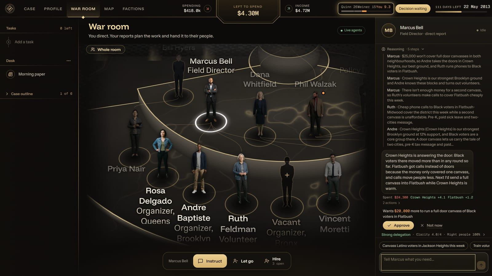
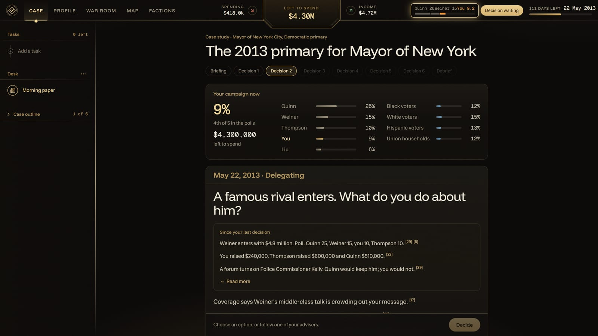
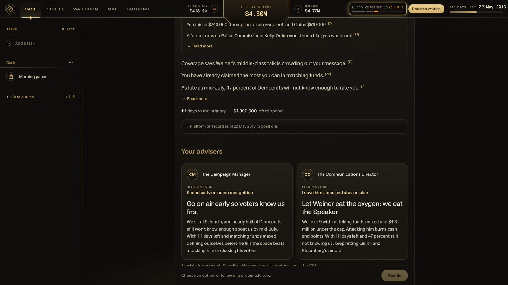
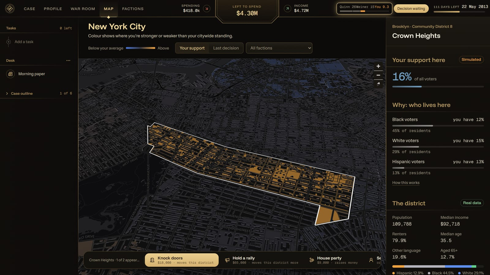
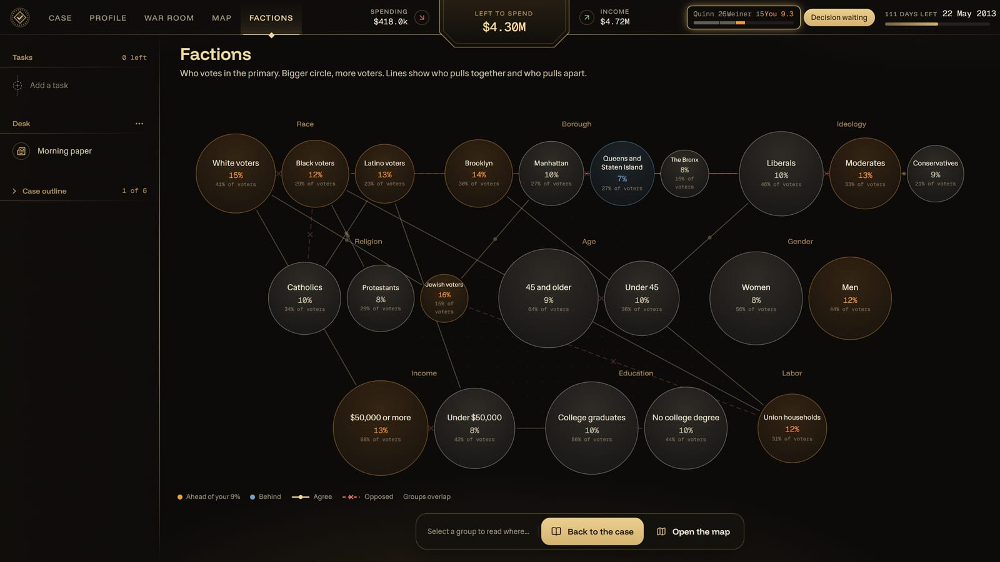
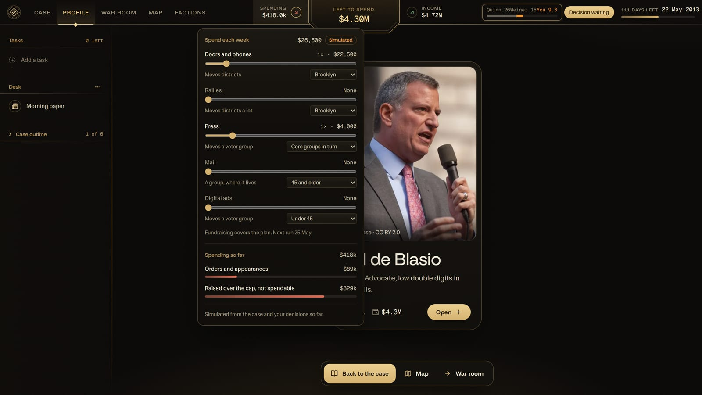
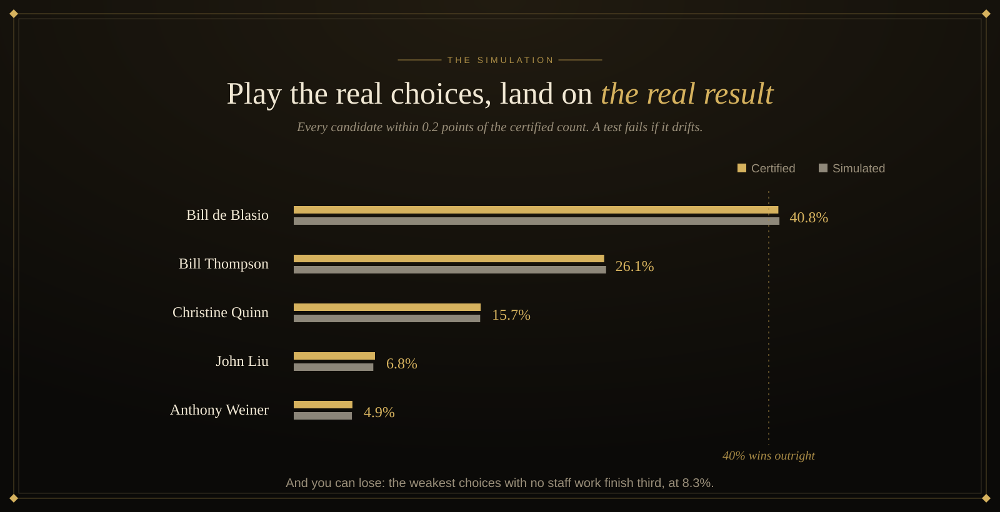

<!-- PROPOSED README (draft). The full, unchanged README is README.md; every detail there still holds.
     Figures: docs/readme/diagrams (rebuild with `node docs/readme/diagrams/build.mjs`). Screens: docs/readme/screens. -->

<h1 align="center">Campaign Academy</h1>

<p align="center"><b>Run a real political campaign with a staff of live AI agents, then see how your choices compare with history.</b></p>

<p align="center">
LangChain deep agents · Claude Opus, Sonnet and Haiku · Gemini · LangSmith · Photon iMessage · Next.js · MapLibre
</p>

<p align="center"></p>
<p align="center"><sub>A live run. You type one order; the Field Director plans it, hands the jobs to two people on his team, spends $24,300 through the game's engine and reports what moved.</sub></p>

---

## The problem

Political science students learn campaigns from the outside: readings, polls, case write-ups, all written after the result is known. They never have to make the calls themselves: how to spend a limited budget, which voters to go after, what to tell a team, what to do when a famous rival enters with $4.8 million. And once you know how a race ended, every choice in it looks obvious.

## The idea

A flight simulator for campaigns. Put the student inside a **real** race, on its **real** calendar, without telling them how it ends. Give them a staff to direct, rivals who fight back and a press that reports it all. At the end, show them their result beside the real one, so they learn from the gap.

## The solution

The first case is the **2013 Democratic primary for Mayor of New York**. You run Bill de Blasio's campaign, which started in fourth place.

- **The race is real.** Polls, money, events and voters come from 55 sources, and every fact on screen is cited. The simulation is fitted to the record: play the real choices and you land on the certified result.
- **The staff are live agents.** Each director is a LangChain deep agent with their own team as subagents. They plan, delegate, spend simulated money through the game's engine and report back.
- **No hindsight.** The agents know only what was known on the game's date, and a filter drops anything that leaks the future.
- **You learn from the gap.** After every decision you see what the real campaign did. How it turned out for them is held back to the end.

---

## How it works

<p align="center"></p>

1. **Briefing, 27 January 2013.** The race on the day de Blasio launched. You are fourth, and 40% wins outright.
2. **A real decision.** On its real date the clock stops. Two of your directors each write a memo for a different option; each option shows its price and which way it moves things.
3. **You decide.** Then you see what changed, and what the real campaign did.
4. **The calendar runs.** You give your staff orders in plain English, send the candidate out on the map and set a weekly spending plan. Rivals make their own moves, and a morning paper reports it all.
5. **Election night, 10 September 2013.** 65 Assembly Districts count in, then the certified result appears beside yours.

<table>
<tr>
<td width="50%"><br><sub><b>A real decision.</b> 22 May 2013: Anthony Weiner enters. Every line is cited.</sub></td>
<td width="50%"><br><sub><b>Your advisers.</b> Two of your own staff argue opposite options. The game never says which is best.</sub></td>
</tr>
</table>

## Inside the app

<table>
<tr>
<td width="50%"><br><sub><b>Map.</b> Real streets and the 59 community districts. Click one for your support, who lives there (census) and where to send the candidate.</sub></td>
<td width="50%"><br><sub><b>Factions.</b> 22 voter groups from the 2013 polls, sized by share of the vote, with the groups that pull together or apart.</sub></td>
</tr>
<tr>
<td><br><sub><b>The morning paper.</b> The lead is the real 2013 headline, cited. The rest is simulated, and you can answer the story.</sub></td>
<td><br><sub><b>The weekly plan.</b> Eight actions bought every week through the same engine as the staff's work.</sub></td>
</tr>
</table>

---

## How it is built

<p align="center"></p>

The game lives in the browser: the case file, the clock and a pure rules engine (`simulate()`: picks in, world out). Every live part runs on the server and has a rules fallback, so the app always runs, even with no API key.

<p align="center"></p>

No model ever sets a poll figure, a cost or an effect. The agents choose actions; the engine prices and scores them. Before a report reaches you, two guards check it: a figure the agent was never shown is sent back once and then dropped, and anything that reaches past the game's date is removed.

## Honest by design

<p align="center"></p>

- Every statement of fact has a source; anything estimated says so.
- The tool never recommends. Advice comes only from your staff.
- The real choice is shown only after you decide, and it is not always the right one.
- A real person appears in a post only where the record names them in it. The rest of the staff are invented.

## Does it work?

<p align="center"></p>

**The simulation is fitted.** The real campaign's six choices, with the rivals acting and a typical weekly plan, land every candidate within 0.2 points of the certified result. Play the weakest choices with no staff work and you finish third.

<p align="center"></p>

**Do the agents decide as the real people did?** We tested it with no student: an agent plays de Blasio, the live agents play everyone else, and each sees only facts dated before the decision. The catch is that the model already knows this race, so plain agreement mostly measures memory. What memory can't fake is whether the choices follow the facts on the card:

- **They follow evidence, not wording.** Rewrite the facts to point away from the 2013 choice and the agent moves 78% of the time; reword the same facts and it holds 94% of the time.
- **On 11 held-out decisions it was never tuned on, the card adds almost nothing to memory** (70% against 67%).

The honest summary: the agents are grounded in the evidence they are given, but they don't reproduce real choices beyond what the model already remembers. The full method and all seven runs are in [README §9](README.md#9-evals-do-the-agents-decide-as-the-real-people-did).

---

## Validation

> **TODO (Devaj):** Devang reached out to about 60 professors and students. Add who tried it, what they said, and the Princeton professor's feedback (what we should be careful about), with the screenshot saved as `docs/readme/screens/validation-princeton.png`.

---

## Tracks

### Education (main track)

> **Draft, to edit.** Campaign Academy is built around how case-method teaching works, with the decision made by the student instead of read about:
> - **Real material, cited.** Every fact links to its source, so a class can check it and argue with it.
> - **Judgment before feedback.** Options preview only the direction of an effect, not its size. You choose, then see what moved, then what the real campaign did.
> - **Four skills a course can assess:** delegating (orders are graded on clarity and on giving the job to the right people), budgeting, reading voter groups and weighing policy trade-offs.
> - **No answer key.** The tool never says which option was best, and the real choice is not always the right one.
> - **More cases are data, not code.** A new race is one researched case file. The shortlist already names the next four.

### LangChain: deep agents and LangSmith

Every live staff member is a LangChain **deep agent** (`deepagents` 1.16.5):

| Agent | What it uses |
|---|---|
| **Staff director**, one per post | `createDeepAgent` with its team as subagents through the `task` tool, run in parallel; a `/memory/AGENTS.md` memory file per post; custom tools `take_action`, `send_report`, `propose` |
| **Staff under a director** | `SubAgent` specs, each with its own model (Haiku 5.5), its own voice and one tool |
| **Rival campaigns** ×4 | `createDeepAgent` with one tool, `make_move`, scored by the same engine |
| **End-of-election debrief** | `write_todos`, a read-only virtual filesystem of the whole campaign and the sourced record, seven subagents in parallel |
| **Evals campaigner** | Read tools and one `decide` tool; every run traced in **LangSmith** (project `campaign-academy-evals`) |

The War room's **Thinking** panel streams the agents' reasoning and hand-offs as they happen. We say plainly what isn't built: the staff director doesn't have `write_todos` yet, there is no checkpointer, and staff traces aren't flushed on Vercel. The full account, with every limit we found, is in [README §5b](README.md#5b-how-the-agents-work-langchain-deep-agents-in-depth).

### Amazon

> **TODO (Devaj):** how it's practical. Not drafted yet.

### Perry

> **TODO (Devaj):** to come.

### Gemini (MLH Best Use of Gemini API)

> **TODO, later.** Gemini (`gemini-3.8-flash`) writes the morning paper's simulated stories, the letters and the three stances you can answer a story with. Every story passes the same number check as the agents, and the masthead names the writer. The lead story is always the real 2013 headline; the model never writes it. *We need a screenshot of a Gemini-written edition: the local key on this machine produced a Claude edition.*

### Photon iMessage

Text a code to the project's iMessage line and your staff text you: remarks arrive signed by the post, you reply YES or with your own order, and the report comes back in the thread. Local demo only for now ([README §5](README.md#texts-on-your-phone-photon-imessage-53-68)).

---

## The technical detail

Everything below lives in [README.md](README.md), unchanged:

<details><summary><b>The case: the 2013 race</b>: candidates, rules, polls, the six decisions, the certified result, why this race</summary>

See [README §7](README.md#7-the-case-the-2013-race) and the sourced research in [`docs/research/2013-mayoral-primary.md`](docs/research/2013-mayoral-primary.md).
</details>

<details><summary><b>Every screen, in detail</b></summary>

See [README §3](README.md#3-a-tour-of-the-app-screen-by-screen).
</details>

<details><summary><b>Evals: setup, conditions, all runs, decisions log, limits, how to run</b></summary>

See [README §9](README.md#9-evals-do-the-agents-decide-as-the-real-people-did).
</details>

<details><summary><b>Testing</b>: automated checks, the full test of 15 Nov, speed</summary>

See [README §10](README.md#10-testing) and [`docs/testing/2026-11-15-full-test.md`](docs/testing/2026-11-15-full-test.md).
</details>

<details><summary><b>The two-minute demo</b></summary>

See [README §4](README.md#4-the-two-minute-demo) and [`docs/demo/judges-walkthrough.md`](docs/demo/judges-walkthrough.md).
</details>

## Built with

| | |
|---|---|
| **App** | Next.js 16, React 19, TypeScript, Tailwind, `motion`, `zustand`, `zod`, `lucide-react` |
| **Map** | MapLibre GL, NYC Open Data, NYC City Planning district shapes, Census ACS |
| **Agents** | LangChain `deepagents`, `langchain`, `@langchain/langgraph`, `@langchain/anthropic`, Claude (Opus 5.5, Sonnet 5.5, Haiku 5.5), LangSmith |
| **Paper** | Google Gemini via `@google/genai` |
| **Texts** | Photon Spectrum (`@spectrum-ts/*`) for iMessage |
| **Data** | NYC Board of Elections, NYC Campaign Finance Board, Quinnipiac and Marist polls, press coverage (55 sources) |

Our own work is the case research, the engine and its fit, the agents' design and guards, the evals and the interface. Built by **Devank Yadav** and **Devaj Solanki**, each directing Claude Code agents ([who built what](README.md#12-who-built-what)).

## Run it

```bash
cd web
npm install
cp .env.example .env.local
npm run dev
```

Every key is optional; without one, each live part falls back to rules. For a rich mid-campaign state, open **⋯ → Load demo start**. Details in [README §13](README.md#13-run-it).
