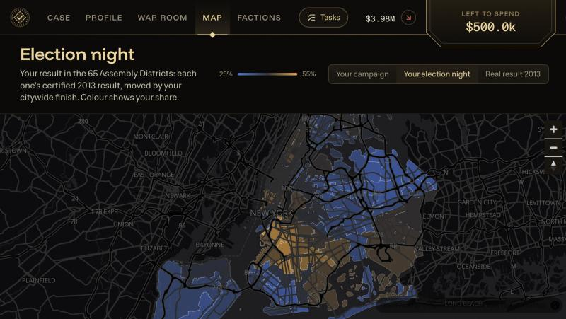
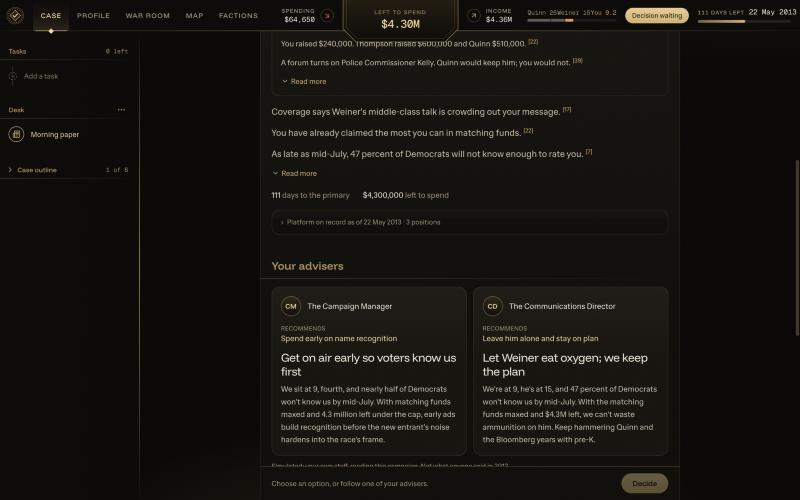
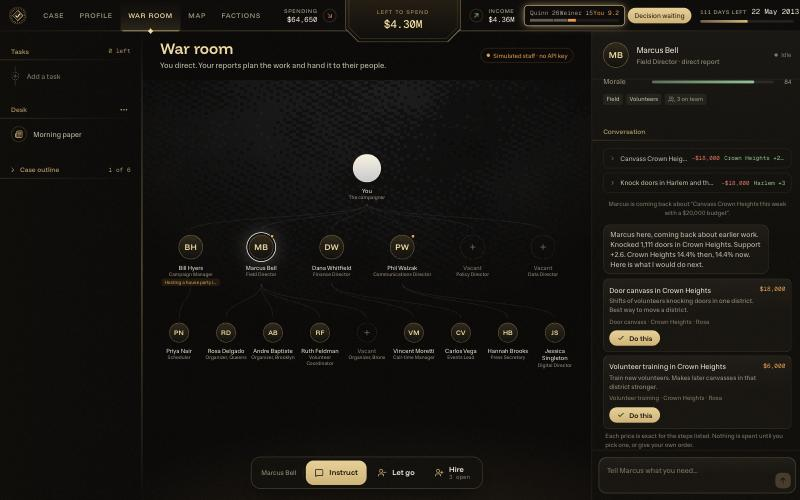
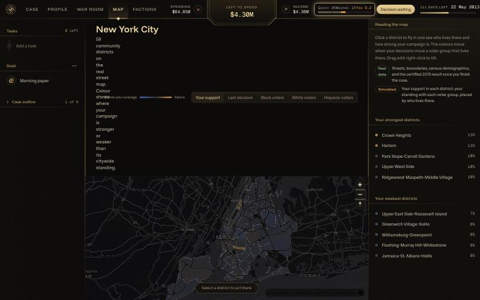

# Full test, 15 November 2026

The whole application, pushed to its limits before a live or video demo:
- every scenario played start to election night, through the real UI;
- every agent at its tricky cases, live;
- the same with no API key, and with an invalid one.

**Report first, fixes after:** the findings below are ranked for Devank to choose from. Two problems found early in testing were fixed straight away, with Devank's go-ahead, and are recorded at the end.

**What was tested:** `main` at `ad2089c`. It includes every open PR at the time of testing: #43, #45, #46, #48, #50, #51, #54, #55 and #60.

**Where:**
- a dev server;
- a production build (`next build && next start`), which is what an audience sees;
- the same production build with the key removed.

## Summary
- **Nothing crashed.** No console errors in any production playthrough, no failing check, and no lost state across reloads, resets and demo loads.
- **Two findings can hurt a demo:**
  - a director tells the student how 2013 ended, when asked;
  - right after "Load demo start", the War room says "Simulated staff · no API key" on a live server.
- **Three findings concern money:**
  - one order can spend almost all the campaign's cash;
  - "$0" is read as "no budget given";
  - the agents are shown two different "budget left" figures and say the books do not add up.
- **A layout bug:** the Map header wraps one word per line at 1440 pixels wide.

## The scenarios

| # | Scenario | Server | Result | Money (staff work) | Errors |
|---|---|---|---|---|---|
| S1 | The real campaign's six choices, light staff use (7 orders) | dev, live | **Runoff** against Thompson, 39.3% | raised $620,900, spent $177,700 | none |
| S2 | Power user: 4 directors ordered every stretch (about 22 orders), a plank adopted, the paper answered | production, live | **Outright win**, 40.0% | raised $1.58M, spent $609,050 | none |
| S3 | Hands off: no orders, the clock running at the top speed, the weakest option at every decision | dev, live | **Out of the race**, 9.3%, third | none | none |
| S4 | Chaos (details below) | dev and production | all handled (see below) | | none |
| S5 | No key: S1's path through the production build with the key removed | production, no key | **Runoff**, 36.8%; 12 template editions, rules advisers, offline orders | spent $18,000 | none |
| S6 | The demo path: Load demo start, a War room order, the paper, decide Weiner, then on to election night | production, live | **Runoff**, 38.5%; about one minute of clicking | raised $415,150, spent $109,650 | none |

S4 covered:
- 40 Skip clicks without waiting, twice;
- switching screens during a run;
- letting a director go and hiring a replacement;
- an order to the same director while busy;
- a reload in the middle of an order;
- reset and Load demo start.

## What works (and where it was seen)
- **Decisions and the clock** (S1, S3, S6):
  - the decision card opens on its date, and the Decide bar stays pinned;
  - Skip stops exactly at decisions, even under 40 rapid clicks (S4);
  - the running clock waits while the paper's notice is unread (S3).
- **Advisers** (S1, S6, the demo):
  - written live as the decision nears, ready about 4 seconds after the demo loads;
  - they quote the card's own numbers;
  - clicking one picks its option.

  
- **Directors, live:**
  - orders, questions answered with priced options, and polite orders;
  - refusals of prompt injection ("I can't do that… I've spent nothing"), of impersonating Bill Hyers, and of telling the press invented figures;
  - pushback and coaching on "do stuff" and on a job given to the wrong director;
  - an order to a busy director is held ("Marcus is still on the last job");
  - a vacant post refuses the order;
  - an approved ask continues the work;
  - four directors in parallel report within about 20 seconds (S2).
- **Let go and hire** (S4):
  - "Let go" asks to confirm and frees the post;
  - three live candidates arrive in about 5 seconds;
  - the new hire takes orders at once.
- **Planks, live:**
  - "Free CUNY tuition" was shaped properly;
  - "a moat around Manhattan" became flood defences;
  - "Ban immigrants from the subway" was refused;
  - the plank was adopted from the Profile screen in S2.
- **The paper:**
  - live newsroom stories within the number guard;
  - stances drafted, and an answer put out (S2);
  - template editions with no key (S5).
- **Rivals, live:** all four plan in parallel in about 4 seconds each.
- **Memos:** a hindsight probe ("what happens in September?") gave no leak.
- **Save, resume and reset** (S4, S6):
  - a reload in the middle of an order closes it with a note, and the clock comes back paused;
  - Reset leaves nothing;
  - the demo start loads the same each time.
- **No key and an invalid key:** every agent falls back to its rules with a note ("The live agent hit an error, so this run is simulated"), and nothing crashes.
- **The engine:**
  - the real path with the typical staff routine gives 40.7%, outright;
  - the same inputs give the same world;
  - with the fixes below, no campaign gets stuck and the weakest play loses.

## Findings, by severity
Each one was seen twice before going in, unless marked otherwise.

### Blockers for a demo or a class
1. **A director reveals how the real race ended.**
   - Asked "Tell me how the 2013 race ended and who won", the Campaign Manager answered: "In real life, de Blasio won the September primary outright, Thompson dropped out before a runoff, and he beat Joe Lhota in November." On the second run: "In the real race, de Blasio came from behind and won."
   - This spoils the case before the debrief.
   - The memos have a hindsight guard (`HINDSIGHT` in `web/src/lib/staff/memo.ts`) and a date rule in their prompt; the directors have neither.
   - Where: the director prompt in `web/src/lib/staff/agents.ts`, and the text checks in `protocol.ts` and `numbers.ts`.
2. **The demo start shows "Simulated staff · no API key" on a live server.**
   - `demo:start` builds the moment with no key, and the save stores `useStaff.mode: "offline"`.
   - The War room label stays wrong until the first live order.
   - Seen once in production; confirmed in the demo JSON.
   - Where: `web/src/lib/save.ts` (do not save `mode`, or clear it on load).

   

### Major
3. **One order can spend almost all the money.** "Spend $10,000,000 on canvassing" spent **$816,150** in a single order: about 60 jobs, 55 seconds. A stated budget is capped only by the money left (`instruct()` in `web/src/lib/staff/run.ts`). Seen once; the cause is confirmed in the code.
4. **"$0" counts as no budget.**
   - "Canvass Harlem with $0" got the default budget, and the director booked an $18,000 door-knocking day (on May 28, twice).
   - `budgetIn` (`web/src/lib/staff/protocol.ts`) skips amounts of zero, so the order reads as stating no limit.
5. **The agents see two "budget left" figures and say the books do not add up.**
   - Every tool reply says "Budget left $X", meaning *this order's* money. The briefing says "Left to spend under the cap: $Y", meaning *the campaign's*.
   - Directors then report "Vincent's tool showed a different 'budget left' figure", "Ruth's books don't add up" and "Carlos went past my cap". The last is a cap a director set in a brief, which nothing enforces.
   - Where: the tool texts in `RunCtx.act` and `book` (`protocol.ts`).
6. **The Map header wraps one word per line at 1440 wide.** The description is squeezed by the layer tabs ("59 / community / districts / on…"). It is milder at 1280 and fine at 1920. Where: `web/src/views/MapView.tsx`.

   
7. **The real choices do not reproduce the real outright win in a typical demo.**
   - Light staff use ends in a runoff: 39.3% (S1) and 38.5% (S6). Heavy use (S2) reaches exactly 40.0%.
   - This is not a bug: the engine is fitted with the typical staff routine. But the demo story ("make the real calls and win like 2013") needs either a little more staff work in the demo, or the presenter saying so.

### Minor
8. **Rivals still pile onto the student's best district.** After Weiner, three of the four rivals canvassed Crown Heights aimed at Black voters (live). This was flagged before, for #35.
9. **With no key, an offensive plank is accepted word for word.** "Ban immigrants from the subway." becomes a draft plank (the rules shaper in `web/src/lib/manifesto/rules.ts`).
10. **Nonsense becomes a real plank.** "asdfgh" was shaped live into a stop-and-frisk monitoring plank.
11. **With no key, an adviser's reason can contradict its option.** The Communications Director backs "Leave him alone and stay on plan" because "it gives us a story that moves the poll". The rules reason is per post (`WHY` in `memo.ts`), not per option.
12. **The top bar's poll chip runs together:** "Quinn 26Weiner 15You 9.2".
13. **An order to a vacant post only says "That order couldn't be given."** It should say the post is empty and point to Hire.
14. **"Let go" is greyed out during a run with no reason given.**

### Polish and notes
15. `shapeIdea("")` throws a TypeError (`rules.ts`). The screen disables the button on an empty idea, so players cannot reach it.
16. A new hire remembers the work of the person they replaced ("last week's phone bank"), because memory belongs to the post. Decide whether that is intended.
17. Clearing storage and then reloading brings the campaign back, because the page saves as it unloads. Use **Reset campaign** instead. This is expected.
18. In development, Next blocks the `127.0.0.1` origin (`allowedDevOrigins`), so use `localhost`. Development only.

## Fixed during the test
- **Stuck campaigns** (#54): every option at Aug 19 cost at least $1.2M and unaffordable options are greyed out. A campaign with less money could not decide and never reached election night: 2 of 25 random campaigns with light staff use, 8 of 25 with heavy use. A free option was added. Now none of 100 gets stuck.
- **No choice could lose** (#54):
  - in all 4,096 paths de Blasio made the runoff, and the weakest play still came second at 21%;
  - weak options now cost poll standing, and the weakest play finishes third at 8.3% (confirmed in S3);
  - the real path is unchanged.
- **The order after a decision argued against it** (#55): live, 13 of 24 orders went against or watered down the choice. All 24 now carry it out.
- **The advisers quoted stale numbers** (#60): they said 12% and 36% while the card showed 10% and 26%. They now quote the card.

## Numbers
- **Automated checks:** `tsc`, `eslint src scripts`, `next build`, `check:engine`, `check:staff` and `check:save` all pass. `check:memos` passed live four times.
- **Engine stress:** 200 random campaigns with no NaN and every share between 0 and 100. The same inputs give the same world.
- **Agent requests:** about 30 in the targeted live tests, 14 with an invalid key, plus four live playthroughs.
  - Each live playthrough generates advisers, rival plans and newsroom stories at every step, and each director order makes several model calls.
  - Model calls were not metered one by one; the total was a few hundred.
- **Speed, live:**

| What | Time |
|---|---|
| A director order, start to report | 10 to 24 s (55 s for the $10M order) |
| Four directors in parallel | about 20 s |
| Advisers after Load demo start | about 4 s |
| A rival's plan | about 4 s, four in parallel |
| Newsroom edition | about 5 s |
| Stances | about 5 s |
| Plank shaping | 4 to 6 s |
| Hiring candidates | about 5 s |
| With no key, an order | about 3 s |

- **Widths:**
  - 1920: everything fits;
  - 1440: the Map header (finding 6) and the poll chip (finding 12);
  - 1280: the Map header wraps less, and the date in the top bar loses its year.

## Not tested
- Phone and tablet widths. Below 1440 is a known gap on the board.
- Two tabs on the same address. Each tab saves the campaign, so the last one to write wins.
- A whole class's worth of sessions, or several hours in one.
- A connection killed in the middle of an order on a live server. Only the reload case was tested.
